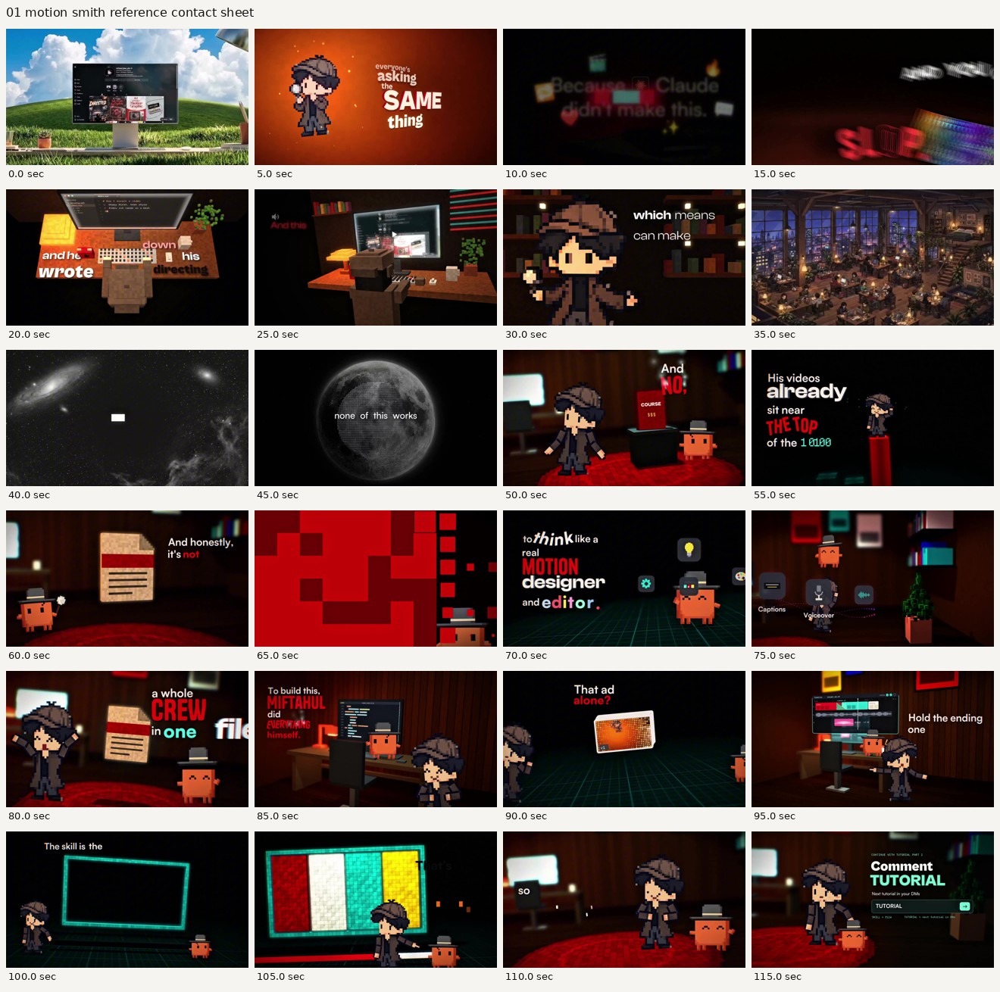
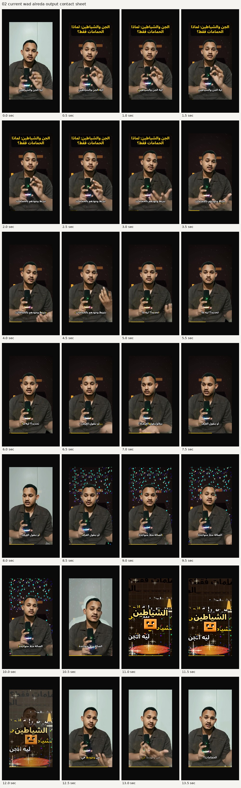
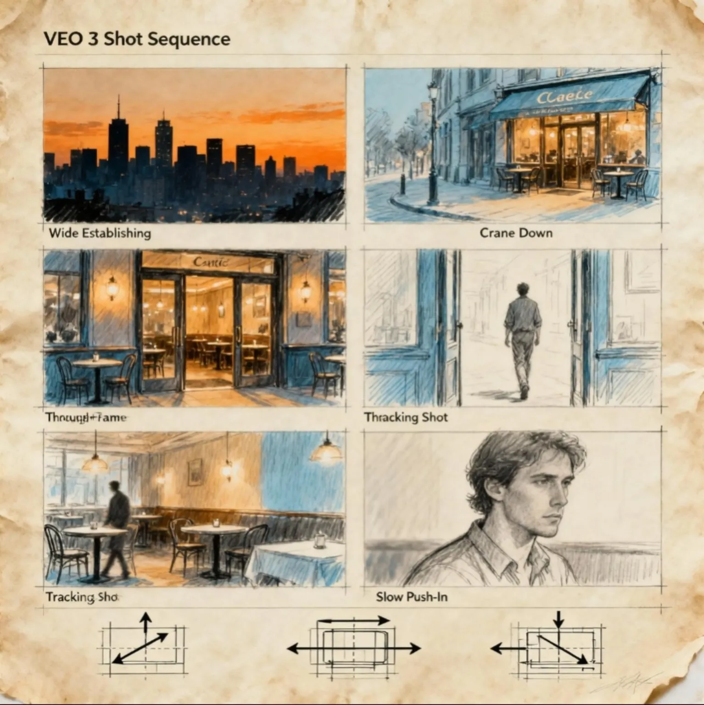
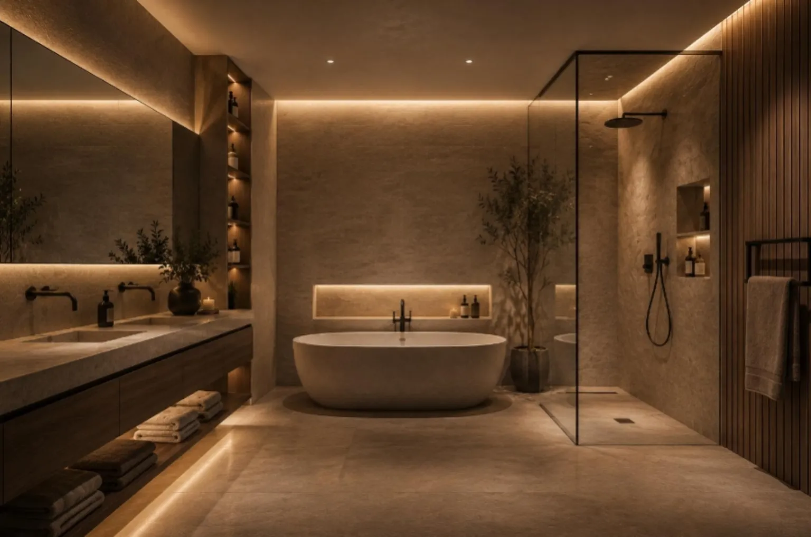
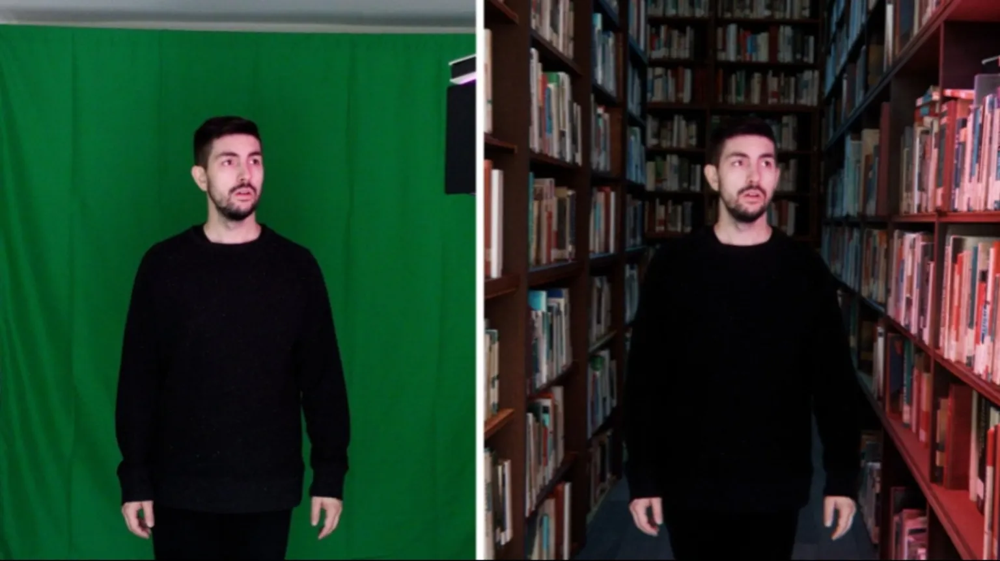

# Wad Alreda AutoEdit — MotionSmith+ 110 Creative Production & Editing Roadmap

**المستودع:** `mmr888336/Wad-Alreda-Auto-Edit-`  
**Baseline المراجع:** Build 361 — commit `71795b9fe09982d94045724aa1fee4f27e5e7fc5`  
**تاريخ إعداد الخطة:** 27 نوفمبر 2026  
**الإصدار:** Revision 4 — REUSE-FIRST، Performance & Pacing Budgets، Local Mock Rewarded Ads، Smart Cinematic Transition Director، Domain Story Packs، Multi-Zone 3D، Post-Export Editor، Automated QA  
**نوع المهمة:** تنفيذ متدرّج داخل Workspace، وليس مجرد اقتراحات أو إنشاء ملفات غير مربوطة.

---

# Revision 4 — قواعد إلزامية أعلى أولوية من أي فقرة قديمة

هذه المراجعة تجيب صراحة عن ثلاثة قيود من صاحب المشروع: **لا تنشئ نظاماً موجوداً أصلاً؛ لا تجعل المونتاج بطيئاً أو إيقاع الفيديو مملاً؛ واجعل إعلانات المكافأة محاكاة محلية بالكامل أثناء فترة التجربة.** عند أي تعارض بين هذا القسم أو ملف `REV4_REUSE_SPEED_AND_REWARDED_ADS_SPEC.md` وبين نص أقدم، طبّق Revision 4.

1. **REUSE-FIRST قبل CREATE:** المستودع يحتوي فعلاً على بنية Story/3D/Assets/Compositor/Timeline/Export وواجهات وإعدادات وإعلانات/شاشة إعلان. يجب قراءة الكود الحالي والبحث عن الوظيفة والـcall sites قبل إنشاء أي class أو service أو screen أو model أو manager جديد. المطلوب الافتراضي هو تعديل أو توسيع الموجود، لا تكراره.
2. **لا ملف جديد بلا إثبات فجوة:** لا تنشئ ملفاً أو class جديداً إلا بعد تسجيل: (أ) ما الذي بحثت عنه، (ب) الملفات/الرموز الموجودة القريبة، (ج) لماذا لا يمكن توسيعها بأمان، (د) كيف سيتصل الملف الجديد بالمسار الحالي. أي بديل مكرر أو API موازٍ يعتبر فشلاً في التنفيذ.
3. **السرعة جزء من الجودة:** لا تنتج فيديو فيه Holds طويلة أو مشاهد ثابتة بلا سبب، ولا تؤخر ظهور المشهد إلى ما بعد الجملة، ولا تقطع الكلام لمجرد تسريع الصورة. حافظ على إيقاع قصصي سريع ومقروء، وقلّل زمن واجهة التحرير والتصدير بتخزين النتائج وإعادة استخدام الأصول والـproxies وتقليل إعادة الترميز.
4. **كل الإعلانات أثناء التجربة محاكاة محلية فقط:** يشمل ذلك أي موضع إعلان موجود حالياً في التطبيق (بما فيه `AdPage`/إعلان ما قبل بدء المونتاج إن كان موجوداً) والموضعين الجديدين `save_to_phone` و`open_timeline`. حافظ على أماكن ظهور البوابات وسلوكها للمستخدم، لكن مرّر كل المواضع عبر Mock Provider محلي موحد. لا SDK إعلانات مهيأ، ولا اتصالات شبكة/طلبات إعلان، ولا impressions/clicks/revenue/callbacks مزيفة. لا تفعّل أي إعلان حقيقي الآن.
5. **لا كسر للميزات الحالية:** افحص الموجود في `main.dart`, `settings.dart`, `AdPage` أو أي Ad/Reward service، `TimelineProject`/`ProjectStore`، خدمات الصور والفيديو، ثم مدّد المسار الحالي. لا تنشئ بوابة إعلانات ثانية أو Timeline ثانية إذا كان عندنا ما يمكن توسيعه.
6. **اختبارات ذكية لا تستهلك الجهاز:** بعد كل إجراء مستخدم نفّذ validation خفيفاً للبيانات المتأثرة. لا تعِد encode للفيديو ولا تشغّل كل اختبارات المشروع بعد كل سحب/تحريك في Timeline. نفّذ اختبارات الوحدة/التحليل بعد كل دفعة كود، وFull Render QA عند اكتمال التصدير أو اكتمال مرحلة.

## أمر التنفيذ إلى DeepSeek Workspace

اقرأ هذا الملف كاملاً مع الصور المرجعية الموجودة في مجلد `references/`. اعتبره مواصفات التنفيذ المعتمدة للمشروع. اقرأ أيضاً كل ملفات `references/` قبل لمس الكود، بما فيها صورة الغلاف الفارغة المرجعية.

**ابدأ بفحص المستودع عند الـcommit الحالي، ثم نفّذ المراحل بالترتيب من Phase 0 إلى Phase 4. المرحلة 1 تشمل Domain Story Packs وSmart Transition Planning؛ المرحلة 3 تشمل محرك الانتقالات الفعلي ومحرر ما بعد التصدير غير التدميري واستيراد صور/فيديوهات الجهاز؛ والمرحلة 4 تشمل الأداء الحراري والاختبارات الآلية وفحص الفيديو.** لا تكتفِ بتلخيص الخطة أو كتابة TODOs؛ نفّذ التغييرات الحقيقية، واربطها بمسار التصدير الفعلي، واختبر كل مرحلة، ثم انتقل تلقائياً إلى المرحلة التالية بعد اجتياز شروط قبول المرحلة السابقة. لا تتوقف لطلب موافقة بين المراحل إلا عند وجود مانع حقيقي يحتاج قراراً أو مفتاحاً غير متاح.

في نهاية كل مرحلة:
1. اذكر الملفات التي تغيرت ولماذا.
2. شغّل التنسيق والتحليل والاختبارات المناسبة، وسجّل النتائج الفعلية.
3. أصلح الفشل في كود الإنتاج أولاً؛ لا تجعل الاختبار ينجح بتخفيف التوقعات أو حذف الاختبار.
4. حدّث `docs/motionsmith_roadmap/EXECUTION_LOG.md` بحالة المرحلة وما بقي.
5. لا تعلن اكتمال ميزة لمجرد وجود كلاس أو نجاح Unit Test؛ أثبت أنها مربوطة بمسار الفيديو النهائي.

**لا تعمل commit أو push أو merge ولا تغيّر إعدادات GitHub Actions دون طلب صريح. لا تطلب من المستخدم رفع ملفات إضافية إذا كانت موجودة بالمستودع؛ افحصها أولاً.** لا تحذف مسار المونتاج الحالي أو ميزاته، ولا تستبدل `enhancer.dart` أو `main.dart` بالكامل لمجرد تسهيل التعديل. اعمل تغييرات إضافية ومحافظة على التوافق، واحتفظ بالمسار القديم كخيار رجوع آمن.

---

## 1. الهدف النهائي

تحويل Wad Alreda من محرر يضيف كابشن وخلفيات ومؤثرات عامة إلى **مخرج فيديو آلي يفهم الكلام، يخطط تسلسلاً بصرياً، يبني بيئات 3D مناسبة للمعنى، يدمج المتحدث داخلها، ويخرج فيديو متماسكاً بإيقاع سينمائي**.

نستهدف جودة الإخراج والإيقاع وتطابق الصورة مع الكلام في فيديو Motion Smith المرفق، وليس نسخ أصوله أو تقليد كل لقطة حرفياً.

### قواعد الهوية البصرية

المرجع `01_motion_smith_reference_contact_sheet.jpg` يوضح أن فيديو Motion Smith يحافظ على هوية متسقة: شخصية متكررة، عوالم متعددة، قصات وتغييرات منظور، كلمات متحركة ومؤثرات مرتبطة بالسرد. هو يستخدم أسلوباً stylized/pixel/voxel متماسكاً عبر الفيديو.

أما أمثلة `05_photoreal_bathroom_environment.jpg` و`06_live_presenter_green_screen_to_library.jpg` فتوضح هدفاً آخر مناسباً للفيديوهات ذات المتحدث الحقيقي: **متحدث حقيقي في المقدمة + بيئة 3D واقعية خلفه**.

لذلك يجب دعم ملفّي إخراج واضحين، وعدم خلط الأساليب عشوائياً:
- `live_cinematic`: متحدث حقيقي + بيئات ومجسمات واقعية، وهو الافتراضي للفيديوهات المصورة الحقيقية.
- `stylized_3d`: شخصية وعالم stylized/voxel/pixel بهوية واحدة متناسقة، عندما يختار المستخدم هذا الأسلوب أو يكون محتوى المشروع مبنياً عليه.

يُمنع وضع متحدث واقعي فوق عالم pixel art أو خلط مجسم واقعي مع عناصر pixel عشوائية، إلا إذا كان ذلك اختياراً مقصوداً داخل خطة المشهد.

### الطموح الإبداعي: MotionSmith+ وليس مجرد تقليد

نريد المحافظة على سرعة ووضوح وإيقاع Motion Smith، ثم إضافة مزايا إخراجية تجعل Wad Alreda أكثر ثراءً في المشاهد التي تناسب المحتوى. لا تجعل كل فكرة مؤثراً منفصلاً؛ اجعلها أدوات داخل Story Director وCamera Director وMotion Graphics Director، تُستخدم عند وجود سبب سردي فقط.

**الهدف البصري المميز:** يمكن أن يبدأ المشهد في مساحة 3D، ثم تتحرك الكاميرا عبر باب أو ممر أو مرآة إلى مساحة ثانية وثالثة مرتبطة منطقياً، مع استمرار نفس الإضاءة والمواد والشخصية/المتحدث ومحور الحركة. ليس شرطاً أن تكون كل جملة في غرفة منفصلة، وليس شرطاً أن يبقى كل مشهد في بيئة واحدة. القرار للسرد.

### مبدأ عدد البيئات داخل المشهد

- ادعم `SceneSequence` واحداً يحتوي على **منطقة واحدة أو عدة مناطق متصلة** (`EnvironmentZones`). غالباً منطقة واحدة تكفي؛ استخدم منطقتين أو ثلاثاً عندما تتطلب الجملة مقارنة أو رحلة أو انتقالاً مكانياً واضحاً. لا تفرض ثلاث بيئات على كل مشهد.
- كل منطقة مكان 3D كامل مستقل من حيث الأرضية والجدران والفتحات والأثاث والضوء والمواد، لكنها مرتبطة بمخطط مكاني (`EnvironmentGraph`) ومنافذ انتقال (`Portal/Connector`) مثل باب أو ممر أو نافذة أو مرآة أو درج.
- مسار الكاميرا يمر من منطقة إلى أخرى فعلياً: dolly through doorway، tracking through corridor، crane reveal، match cut، أو cut واضح عندما لا يوجد اتصال مكاني منطقي.
- ثبّت `continuityKey`, محور 180-degree، اتجاه الإضاءة، وقت اليوم، مقياس الأصول، ومسار حركة الكاميرا لمنع قفز المكان أو تبدّل الأثاث بلا سبب.
- يجب الفصل بين **المشهد الدلالي** (الفكرة/Beat) و**اللقطة** (Shot) و**المنطقة** (Zone). قد يحتوي Beat واحد على عدة لقطات وعدة مناطق؛ وقد تتشارك عدة Beats المكان نفسه مع تغيّر زاوية التصوير أو عنصر التركيز.
- مثال الفيديو المرجعي: عند الحديث عن الحمام يمكن أن يبدأ بلقطة عامة للحمام، ثم تمر الكاميرا قرب المغسلة/المرآة، ثم عبر الباب إلى الممر، ثم تكشف الغرفة أو الصالة عند انتقال الكلام إليها. لا تقفز الكاميرا إلى مكان غير مرتبط لمجرد إضافة تنويع.

**مكتبة البيئات المطلوبة قابلة للتوسعة وليست قائمة جامدة:** bathroom (modern/luxury/simple/public)، bedroom، living_room، kitchen، office، library، cafe، restaurant، classroom، clinic/hospital، workshop، shop/market، street/city، transport/airport، outdoors/nature، desert/mountain، warehouse/industrial، studio، historical/heritage، وabstract/diagram space للشرح المجرد. يجب أن يدعم كل نوع Variants متعددة ومواد وإضاءة وأثاث مختلفاً، لا نسخة واحدة مكررة بلون مختلف.

### أمثلة مرجعية يجب تحويلها إلى اختبارات

- **الفيديو المرجعي Motion Smith:** مدته نحو 120 ثانية، 1280×720، 30fps. راقب تنوع المشاهد، تكرار الشخصية، الانتقالات، تحريك الكاميرا، الكلمات المتحركة، وتغيير التكوين بما يخدم الجملة.
- **ناتج Wad Alreda المرفق:** 13.9 ثانية، 1440×2560، 30fps. في العينة المرفقة يظهر المتحدث أغلب الوقت أمام خلفية شبه ثابتة ومظلمة، ثم مربعات/جزيئات عامة، ثم تكوين Pixel/نصوص متداخلة قرب النهاية. المشكلة ليست غياب المؤثرات فقط؛ بل ضعف ارتباط الصورة بالكلام، وعدم وجود انتقالات بين بيئات تشرح الجمل، وعدم اتساق الأسلوب في نهاية المقطع. لم تتضمن بيانات ملف الفيديو إثباتاً داخلياً لرقم Build الذي أنشأه؛ استخدمه كمرجع بصري، ولا تنسبه إلى Build محدد دون سجل التصدير.
- **Storyboard VEO 3:** `03_veo3_six_shot_storyboard.jpg` يوضح تسلسلاً متصلاً: Wide Establishing → Crane Down → Through-Frame → Tracking Shot → Tracking داخل المكان → Slow Push-In. المطلوب تعلم قواعد الإخراج والاستمرارية، لا نسخ مشهد المقهى.
- **مكتبة الحمام:** `04_bathroom_real_asset_kit.jpg` و`05_photoreal_bathroom_environment.jpg` أمثلة على الأصول المفصلة والبيئة المركبة المطلوبة، بدلاً من صناديق هندسية.
- **المتحدث الحقيقي:** `06_live_presenter_green_screen_to_library.jpg` مرجع للحفاظ على الشخص الحقيقي ودمجه في بيئة مناسبة مع تحسين الحواف.
- **سير عمل المونتاج:** `07_professional_editing_workflow_reference.jpg` مرجع لجودة الترتيب والمراجعة، وليس شرطاً لبناء واجهة جديدة في هذه المهمة.

### لوحة المراجع المرئية

**Motion Smith — مرجع الإيقاع والعوالم والكتابة الحركية**

**ناتج Wad Alreda الحالي — نقاط الخلل المطلوب علاجها**

**تسلسل اللقطات، الأصول الواقعية، ودمج المتحدث**

### هدف 110 — ماذا يعني تجاوز Motion Smith؟

نريد أن يكون الهدف **110/100 كطموح في اكتمال المنتج وقدراته، وليس وعداً بأن كل فيديو سيكون أجمل من Motion Smith بنسبة 10%**. يتم فصل القياس إلى:

- **100 نقطة أساسية:** جودة السرد البصري، مطابقة المشاهد للكلام، تنوع وواقعية البيئات، حركة الكاميرا، نعومة الانتقالات، دمج المتحدث، Motion Graphics، جودة المونتاج، ثبات التصدير، والأداء.
- **10 نقاط تفوق وظيفي إضافي:** (1) Domain Directors متخصصة للتاريخ والدين والعلوم والرياضة وغيرها، (2) انتقالات سينمائية ذكية متكيفة مع المكان والحركة، (3) Multi-Zone 3D مع رحلة كاميرا داخل المشهد الواحد، (4) محرر غير تدميري بعد التصدير يستورد وسائط الجهاز، (5) تحكم حراري وأداء متكيف مع Quality Gate آلي.

**طريقة القياس:** نفس المواد الصوتية/الفيديوهات المرجعية، نفس مدة الفيديو ونسبة الأبعاد، ومقارنة Side-by-Side بواسطة Rubric ثابت. الدرجة البصرية تظل من 100؛ نقاط التفوق العشر تقيس قدرات المنتج الإضافية فقط. لا تُمنح أي نقطة من دون تكامل واختبار وإثبات مرئي على جهاز فعلي. يمكن أن ينتهي المشروع بدرجة أقل من 110 إن لم تتحقق الشروط.

- خط الأساس الهندسي المراجع سابقاً: نحو 35–36%، وليس درجة جودة فيديو نهائية.
- هدف الوصول إلى parity بصري في نطاق المحتوى المدعوم: 90–100/100 بعد التحقق.
- هدف MotionSmith+ الوظيفي: حتى 110/100 عند تحقق الـ100 الأساسية وإثبات الإضافات الخمس.
- لا تستخدم هذه النسب كادعاء تسويقي قبل وجود تقارير مقارنة وفيديوهات معتمدة.

---

## 2. خط الأساس الحالي — لا تبدأ من الصفر

آخر Build موثّق في المستودع عند إعداد الخطة هو **361**، ونجح فيه 682 اختباراً ونُشر APK بحجم يقارب 182.1MB. نجاح CI لا يعني أن الجودة البصرية وصلت إلى الهدف.

التقديرات التالية هي **نسبة اكتمال هندسي تقريبية من مراجعة الكود**، وليست درجة جودة الفيديو ولا قياساً آلياً:

| النظام | ما هو موجود حالياً | التقدم التقريبي |
|---|---|---:|
| A. Story Director | تحويل الكابشنات إلى StorySegments، وتصنيف بالكلمات المفتاحية، وبيئات/مزاج/إشارات كاميرا محدودة | 20% |
| B. 3D Asset Engine | خدمات بحث وتنزيل لـSketchfab وPoly Haven وHugging Face، وQuery Planner وفحص GLB؛ لكن ربط الأصول بمخطط عالم القصة غير مكتمل | 40% |
| C. 3D World Director | Filament وGLB Builder وإضاءة وSkybox ومسار كاميرا و12 نوعاً من قطع البيئة التفصيلية؛ لكن البيئات ما زالت محدودة وإجرائية والشخصية ليست هيكلية متحركة متكاملة | 35% |
| D. Character Compositor | Person Segmentation Matte وتركيب العالم والنصوص فوقه؛ لكن جودة الحواف وسلوك الفشل والظهور المستمر يحتاج إصلاحاً | 45% |
| E. Motion Graphics Director | كابشن متحرك وكلمات نشطة وعناوين وCallouts وفلاتر ومؤثرات أساسية | 40% |
| F. Render QA | فحص ملفات GLB ومشاهد سوداء/شفافة/مسطحة وCrash Guard وفحص الغلاف؛ لكن لا يوجد فحص دلالي نهائي متكامل، والغلاف يُنشأ قبل دمج 3D | 30% |

**المتوسط التقريبي الحالي: 35–36%.** لا تجمع النسب على أنها مهام منجزة بالكامل. يمكن إعادة تقديرها عند نهاية كل مرحلة، مع دليل من الكود والاختبار ومقطع فيديو فعلي.

### ملاحظات دقيقة من خط الأساس

1. `ThreeDScenePipeline._captionSegments` يبني القصة من طبقات الكابشن، و`StoryUnderstanding` يصنف النص عبر قائمة مفاهيم/محفزات محدودة. هذا لا يساوي فهماً سياقياً كاملاً للجمل.
2. `CinematicWorld.layouts` يحتوي بيئات ثابتة محدودة. لا يوجد تعريف بيئة حمام أو مقهى أو مطبخ ضمن التخطيطات الحالية، ولذلك لا يكفي وجود كلمة في الكابشن لبناء المكان.
3. `StoryWorldBridge.propVisuals` قائمة محدودة للأيقونات/الصور، و`World3DPlanner` يبني الجدار والأرضية والقطع المعروفة والشخصية الإجرائية وBillboard props.
4. `ThreeDAssetService` موجود فعلاً لمصادر Sketchfab وPoly Haven وHugging Face، و`ThreeDQueryPlanner` يحول النص إلى كلمات بحث. لكن مسار `World3DPlanner` الحالي يبني عالمه من `CinematicWorld` وقطع إجرائية ثابتة؛ يجب وصل خدمة الأصول بمخطط العالم نفسه، لا إنشاء خدمة بحث ثانية منفصلة.
5. `World3DSetPieces` يحتوي تفاصيل هندسية لقطع مثل desk/window/bookshelf/lamps/building_row/monitor_wall وغيرها. هذه بداية جيدة وFallback فقط، وليست بديلاً عن نماذج واقعية ذات خامات.
6. `WorldSceneCompositor` يحاول قص الشخص وإعادة الكابشن والعنوان. لكن عند فشل الـmatte أو فشل تركيب الـextras توجد مسارات قد تخرج العالم دون الشخص أو النصوص. يجب أن يصبح الفشل آمناً ولا يمر بصمت.
7. `Enhancer.run` ينشئ الغلاف من `cutPath` قبل أن يستدعي `main.dart` مسار `ThreeDScenePipeline.apply`. Build 358 حسّن منع الغلاف الشفاف/الفارغ، لكنه لم يجعل الغلاف مأخوذاً من الفيديو النهائي بعد تركيب 3D.

---

# 3. مراحل التنفيذ

## Phase 0 — تثبيت خط الأساس، جرد الموجود، ومنع التكرار

**الهدف:** لا يبدأ DeepSeek بالبرمجة قبل أن يعرف ما هو موجود فعلاً، وما الذي يحتاج تعديل/توصيل/استبدال محدود، وما الفجوة الوحيدة التي تستحق ملفاً جديداً.

### 0.1 جرد إلزامي للكود والميزات
- اقرأ أحدث HEAD فعلياً، `git status`، بنية المشروع، ملفات `lib/` و`test/` و`packages/` وAndroid وملفات CI ذات الصلة. Build 361 مرجع تاريخي فقط، وليس افتراضاً أن HEAD الحالي لا يزال هو نفسه.
- استخدم بحثاً نصياً ودلالياً عن أسماء الوظائف والـclasses والـwidgets والـservices وعمليات التصدير قبل إنشاء أي رمز جديد. ابحث عن الاسم والمرادفات والـcall sites، وليس عن اسم الملف فقط.
- تتبّع مساراً كاملاً لكل من: اختيار الفيديو، قص الصمت، Enhance، 3D export، Save to phone، فتح المكتبة، فتح Timeline، استيراد ملفات المعرض، الإعلانات/المكافأة، الإعدادات، وحفظ واستعادة المشروع.
- لا تعتمد على وثيقة Rev3 أو Rev4 باعتبارها وصفاً مؤكداً للـHEAD الحالي؛ افحص كل ملف ووقّع النتائج بالـSHA الحالي.

### 0.2 مصفوفة قرار قبل التنفيذ
أنشئ جدولاً في `EXECUTION_LOG.md` لكل ميزة بالحقول التالية:

| المطلوب | الموجود حالياً والملفات/الرموز | قرار التنفيذ | ما الذي سيتغير | اختبار إثبات التكامل |
|---|---|---|---|---|
| Story understanding | `StoryUnderstanding`, `CinematicWorld`, `StoryWorldBridge` أو ما يقابلها | REUSE/EXTEND/REFACTOR/NEW | ... | ... |
| 3D assets | `ThreeDAssetService`, `ThreeDQueryPlanner`, `KhronosModelCatalog` | ... | ... | ... |
| 3D world / camera | `World3DPlanner`, `World3DGlbBuilder`, `World3DSceneRunner`, `World3DRig` | ... | ... | ... |
| Person / compositing | `PersonTrackingService`, `PersonSegmentationMatte`, `WorldSceneCompositor`, `PersonAnchoredCompositor` | ... | ... | ... |
| transitions / graphics | `motion_transitions.dart`, `motion_graphics.dart`, `MotionCutawayRenderer`, `WorldSceneCamera` وأي بديل موجود | ... | ... | ... |
| Timeline / project editor | `TimelineProject`, `timeline_engine.dart`, `ProjectStore`, شاشات Editor/Timeline الحالية | ... | ... | ... |
| ads / rewarded actions | `AdPage` وأي Ad SDK/Ad service/Reward gate موجود | ... | ... | ... |
| save to device / gallery | وظيفة الحفظ الحالية وPhoto Picker/SAF وأي Media service | ... | ... | ... |
| speed / cache / thermal | cache/proxy/FFmpeg/Filament/lifecycle/profile الموجود | ... | ... | ... |

القيم المسموحة لقرار التنفيذ: `REUSE` (الموجود يكفي، لا تغيّر التصميم)، `EXTEND` (أضف وظيفة إلى الموجود)، `REFACTOR` (حسّن الموجود مع توافق خلفي واختبارات)، `NEW` (لا يوجد بديل؛ مع توثيق سبب إنشاء الجديد). لا تستخدم `NEW` لمجرد أن إنشاء كلاس جديد أسهل.

### 0.3 خريطة إعادة الاستخدام الأولية — يجب التحقق من HEAD
هذه أسماء معروفة من خط الأساس، وهي نقاط بداية للبحث لا إذن بإنشاء نظائر لها:
- Story: `story_understanding.dart`, `cinematic_world.dart`, `story_world_bridge.dart`, `three_d_scene_pipeline.dart`.
- Assets: `three_d_asset_service.dart`, `three_d_query_planner.dart`, `khronos_model_catalog.dart`, `glb_inspector.dart`.
- 3D: `world3d_model.dart`, `world3d_planner.dart`, `world3d_set_pieces.dart`, `world3d_glb_builder.dart`, `world3d_scene_runner.dart`, `world3d_rig.dart`, Filament native plugin.
- Person/composition: `person_tracking_service.dart`, `person_segmentation_matte.dart`, `person_anchored_compositor.dart`, `world_scene_compositor.dart`, `three_d_scene_pipeline.dart`.
- Transitions/graphics: `motion_transitions.dart`, `motion_scene_model.dart`, `world_scene_camera.dart`, `world_look_grade.dart`, `motion_graphics.dart`, `motion_cutaway_renderer.dart`.
- Export/storage: `main.dart`, `enhancer.dart`, `silence_cutter.dart`, `timeline_engine.dart`, `project_store.dart`, `scene_frame_guard.dart`.
- Ads/UI: افحص `AdPage` الموجودة ومكان استدعائها الحالي وأي ad/reward abstractions؛ لا تنشئ AdPage ثانية ولا SDK جديداً.
- Timeline: افحص نموذج التايم لاين والتخزين والـwidgets الحالية. وجود `TimelineProject` لا يثبت وجود محرر تفاعلي، لكنه يعني أن المحرر يجب أن يتصل بنفس مصدر البيانات ولا ينشئ نموذج مشروع موازياً.

### 0.4 خط أساس الأداء
- على جهاز اختبار فعلي، سجّل زمن كل مرحلة من اختيار الفيديو حتى أول Preview ثم Export النهائي. سجّل مدة الفيديو ودقته/FPS وحجمه ووقت التحليل والتنزيل والرسم وFFmpeg ووقت الانتظار أمام المستخدم.
- سجّل زمن استجابة Timeline/Scrub/Preview واستهلاك الذاكرة والحرارة إن كانت APIs متاحة.
- استعمل نفس ملف اختبار 15 ثانية ونفس إعدادات الإخراج لكل مقارنة قبل/بعد.
- لا تخترع قيماً إذا لم يتوفر الجهاز؛ سجّل أن القياس غير متاح، ولا تعلن تحقيق ميزانية الأداء.

### 0.5 مخرجات Phase 0
- `EXECUTION_LOG.md` يحتوي SHA/branch/status، call graph، matrix reuse-first، قائمة الاختبارات، وخط أساس الأداء.
- قائمة صريحة بالملفات الموجودة التي ستُعدل، والملفات الجديدة المبرر إنشاؤها فقط.
- عدم حذف أو تعطيل المونتاج والصوت والكابشن وB-roll و3D الحالي أو شاشة الإعلان الموجودة.

**شرط القبول:** لا يبدأ Phase 1 حتى تكتمل مصفوفة القرار. كل اقتراح لملف جديد بلا إثبات فجوة يُرفض ويعاد إلى تعديل الموجود.

## Phase 1 — Story Director + Multi-Environment Shot Planning

**الهدف:** يفهم التطبيق كل فكرة منطوقة، ويقرر ماذا يجب أن يرى المشاهد ومتى، ثم يحولها إلى تسلسل لقطات ومناطق متصلة بدلاً من اختيار خلفية واحدة لكل Caption.

المطلوب:
- حلّل الصوت/الكابشن بتوقيتات فعلية، مع تجميع الكلمات في Beats مكتملة دلالياً. لا تجعل كل سطر Caption مشهداً مستقلاً إذا كان امتداداً للفكرة نفسها.
- وسّع `StoryUnderstanding` و`CinematicWorld` و`StoryWorldBridge` الموجودين مع الاستفادة من `AiRouter` ومقدمي AI الموجودين. لا تنشئ StoryPlanner/StoryEngine ثانياً إذا أمكن إدخال المخطط داخل المسار الحالي.  استخدم AI لتخطيط JSON منظم عند توفره، وLocal semantic fallback عند غياب الشبكة أو المفتاح. لا توقف التصدير بسبب فشل AI.
- أضف نموذجاً واضحاً يحتوي على `StoryBeat`, `SceneSequence`, `ShotPlan`, `EnvironmentZone`, `EnvironmentGraph`, `PortalLink`, `CameraWaypoint` و`ContinuityState` أو أسماء مكافئة.
- كل Beat يجب أن يحمل: `start/end`, النص المنطوق، intent، visual explanation، الحقائق/العناصر المطلوبة، العلاقات (مقارنة/سبب-نتيجة/مثال/مجاز)، الثقة، أسلوب الفن، خطة اللقطات، المناطق، حركة الكاميرا، نوع الانتقال، أولوية الشخص والكابشن، وخطة fallback.
- لا تكتفِ باستخراج كلمة (حمام/غرفة)؛ افهم ماذا يفعل المتحدث بهذه الكلمة: يشرح مكاناً، يقارن مكانين، يذكر خطراً، يحكي قصة، أو يستخدم استعارة. لا تحوّل الكلمات المجازية إلى جسم حرفي غير مناسب.
- **Multi-Zone داخل المشهد:** اسمح للـBeat الواحد أن يحتوي منطقة واحدة أو منطقتين أو ثلاث مناطق متصلة عند الحاجة. حدّد لكل Zone العناصر/الأصول وموقعها وفتحات المرور منها وإليها. إذا كانت المقارنة فكرية بين مكانين غير متصلين، استخدم انتقالاً تحريرياً واضحاً بدلاً من اختراع ممر.
- عند الحديث عن أماكن متتابعة مثل حمام ثم غرفة ثم صالة، أنشئ ShotSequence يمكن أن تبدأ من لقطة حمام واسعة، تنتقل عبر الباب/الممر، ثم تكشف الغرفة أو الصالة عند وقت نطقها. لا تؤخر تغيير البيئة ولا تقدّمه عن الجملة.
- أنشئ shot vocabulary: Establishing Wide، Crane Down/Up، Dolly/Push-In/Pull-Out، Orbit، Truck/Tracking، Through-Frame، Rack Focus، Over-Shoulder، Detail Insert، Close-Up، Reveal، Match Cut، Whip Pan، وStatic Hold عند الحاجة. لا تستخدم كل الأنواع في كل فيديو.
- أنشئ `TransitionDirector` / `TransitionPlan` من مرحلة التخطيط، ويختار تلقائياً الانتقال الأنسب بين كل Shot والتي تليها. يجب أن يأخذ القرار في الاعتبار: علاقة المعنى، اتجاه وسرعة حركة الكاميرا، تماثل الشكل/الموضع، اتصال البيئة والـPortals، حركة الشخص، مواضع النصوص، إيقاع الصوت، مدة اللقطتين، أسلوب الفيديو، وقدرة الجهاز. لا تختَر انتقالاً لمجرد التنويع.
- لا تستخدم Fade كحل افتراضي. الأفضل انتقال كاميرا مستمر داخل 3D عندما يكون المكان متصلاً، أو Match-on-Action/Match Cut/Portal/Foreground Occlusion/Whip Pan محسوب عندما يتطلب السرد ذلك. استخدم Crossfade فقط إذا كان مقصوداً (ذكرى، حلم، مرور زمن، مونتاج ناعم) وليس لتعويض غياب التخطيط.
- المواصفات التفصيلية والأنواع ومعيار الاختيار في `TRANSITION_DIRECTOR_SPEC.md`؛ اعتبره جزءاً إلزامياً من هذه الخطة.

- خطط استمرارية: نفس المكان له `continuityKey`، والأثاث لا يتغير بلا سبب، ومحور الحركة لا ينقلب عشوائياً، والإضاءة ووقت اليوم والمواد متوافقة بين اللقطات.
- استخدم المدة الفعلية للجملة والوقفة والتنفس. احفظ وضوح الكلام؛ القصات القصيرة جداً (مثل 0.1–0.3s) لا تستخدم إلا كـimpact insert أو montage متعمد، ولا تقطع كلمة منطوقة أو تجعل النص غير قابل للقراءة.
- لكل قرار اكتب تفسيراً داخلياً منظماً: لماذا هذه البيئة؟ لماذا هذا الأصل؟ لماذا حركة الكاميرا؟ لماذا هذه المدة؟ وما الذي سيظهر إن لم يتوفر أصل مناسب؟ لا تعرض هذا كسرد طويل أثناء التصدير؛ استخدمه للتشخيص.
- وفّر إعدادات أسلوب للمستخدم: `live_cinematic`, `stylized_3d`, `educational_explainer`, `documentary`, `dramatic`, `minimal_clean`. الإعداد يحدد الستايل ولا يغيّر حقيقة المحتوى.

### Domain Story Directors — تخصص الموضوع قبل اختيار الصورة

لا تجعل كل المحتوى يمر عبر قاموس واحد محدود. أنشئ طبقة `DomainRouter` تختار Domain واحداً أو عدة Domains للموضوع، ثم تستدعي `DomainStoryPack` متخصصاً يحتوي على: مفاهيم ومصطلحات، ontology للعناصر والأماكن، shot grammar، مكتبة بيئات وأصول، transitions مناسبة، palette/style، متطلبات الدقة والمصادر، ومحظورات التمثيل الخاطئ. استخدم AI الموجود لتحليل السياق عند توفره، مع fallback محلي، ولا تجعل فشل الشبكة يوقف التحرير.

**حزم المجالات المطلوبة في الإصدار الأول (قابلة للتوسع):**
1. `history_archaeology`: التاريخ، الحضارات، العصور، الآثار، العمارة والملابس والأدوات حسب الحقبة والمكان.
2. `religion_spirituality`: الإسلام والموضوعات الدينية المقارنة؛ عرض محترم ورمزي، دقة النصوص والمصادر، بلا تجسيد للذات الإلهية أو الأنبياء، ولا اختلاق هيئة غيبية للملائكة أو الجن.
3. `science_nature`: الفيزياء والكيمياء والأحياء والبيئة، مخططات وتجارب ونماذج توضيحية مع الوحدات والمقاييس الصحيحة.
4. `sports`: كرة القدم والسلة والتنس والرياضات القتالية واللياقة؛ ملاعب ومعدات ومسارات حركة وقواعد صحيحة.
5. `medicine_health`: تشريح وفسيولوجيا وصحة؛ نماذج تعليمية دقيقة، تنبيه إلى أن التوضيح البصري ليس تشخيصاً أو نصيحة علاجية.
6. `education_study`: الفصول والمختبرات والمفاهيم التعليمية والخرائط الذهنية.
7. `technology_ai`: الحواسيب والهواتف والذكاء الاصطناعي والبرمجيات والشبكات.
8. `business_economics`: التجارة والمال والأسواق وسلاسل الإمداد وريادة الأعمال.
9. `geography_travel`: الدول والمدن والمعالم والخرائط والطبيعة والرحلات.
10. `biography_people`: سِيَر الشخصيات والأحداث الحياتية مع فترات زمنية ومواقع مناسبة.
11. `culture_heritage`: الثقافات والعمارة والملابس والحرف والعادات المحلية دون تنميط.
12. `space_astronomy`: الكواكب والنجوم والمركبات الفضائية ومقاييس الفضاء.
13. `engineering_inventions`: الآلات والجسور والمحركات والاختراعات ومقاطع التفكيك والشرح.
14. `law_civics`: المؤسسات والمحاكم والحقوق والإجراءات المدنية بصور توضيحية غير مضللة.
15. `environment_climate`: المناخ والمياه والطاقة والزراعة والتلوث والحلول البيئية.
16. `food_cooking`: المطابخ والأطعمة والمكونات وخطوات التحضير.
17. `psychology_society`: العلاقات والسلوك والمجتمع مع تجنب تحويل المجاز إلى تشخيص نفسي.
18. `news_current_affairs`: الأحداث الجارية فقط عند وجود مصدر حديث موثوق وتاريخ مرجعي؛ لا تخترع صوراً توثيقية لحدث واقعي.
19. `conflict_military_history`: التاريخ العسكري والجغرافيا والمعدات مع تجنب التمجيد أو المشاهد الدموية غير اللازمة.
20. `arts_media_entertainment`: السينما والفنون والتصميم والألعاب والموسيقى بصياغة مرئية مناسبة.
21. `architecture_real_estate`: المباني والفراغات الداخلية والمخططات والمواد.
22. `everyday_explainer`: الحياة اليومية والموضوعات المختلطة التي لا تحتاج مجالاً متخصصاً.

**ضوابط المصداقية:**
- في التاريخ: لا تخلط العصور، العمارة أو اللباس أو الأدوات. خزّن `period`, `region`, `sourceConfidence`، ووسم `dramatized` لأي إعادة بناء فنية غير موثقة.
- في الدين: لا تعرض نص آية أو حديث إلا من مصدر نصي مضبوط، لا تصنع نسبة أو قصة أو هيئة غيبية، لا تجسّد الأنبياء أو الذات الإلهية، واستخدم العمارة والمخطوطات والطبيعة والرموز المحايدة عند الحاجة. عند وجود خلاف أو ضعف رواية سجّل ذلك ولا تعرضها كحقيقة قطعية.
- في العلوم والطب: لا تغيّر الوحدات أو المقاييس، وميّز النموذج التوضيحي عن التصوير الحقيقي. لا تخترع بيانات أو نتائج تجارب.
- في الرياضة: حافظ على قياسات الملعب، عدد اللاعبين، المعدات، قوانين الحركة وتوقيت الحدث؛ لا تعرض وضعيات جسدية غير ممكنة.
- في الأخبار: يلزم مصدر وتاريخ، وإلا استخدم أسلوباً عاماً غير منسوب لحدث حقيقي أو اطلب مادة موثوقة من المستخدم.
- يجب أن يستطيع الفيديو الجمع بين أكثر من Domain، مثل التاريخ + الجغرافيا، أو الدين + التاريخ، أو العلوم + الطب.

**اختبارات القبول:** أعطِ النظام نصوصاً عربية قصيرة من كل Domain، وتأكد من اختيار Domain صحيح، والمفردات والبيئات والأصول واللقطات. أضف حالات غامضة ومجازية ومتعددة المجالات. اختبر النصوص الدينية والتاريخية والعلمية ضد مصدر/مرجع محدد؛ لا يكفي أن يكون المشهد جميلاً إذا كان مضللاً.

**اختبارات قبول Phase 1:**
- نص الحمام يجب أن ينتج Bathroom Zone بعناصر مثل sink/vanity، shower، toilet/bathtub، mirror، tiles/door حسب معنى الجملة.
- عندما ينتقل الكلام إلى غرفة أو صالة، يظهر ذلك في توقيت الكلام. اختبر Beat فيه 2–3 مناطق في SceneSequence واحد، مع portal/camera route صالح أو cut مبرر.
- سيناريو المقهى ينتج ShotSequence متصلة: Wide Establishing → Crane Down → Through-Frame → Tracking → Interior Tracking → Slow Push-In، مع استمرار نفس المكان.
- اختبار موضوع غير متعلق بالحمام (مال/تقنية/صحة) يختار عالمه الصحيح.
- اختبار مجاز لا ينتج جسماً حرفياً غير مناسب.
- فشل AI أو JSON غير صالح لا يوقف التصدير، ويظهر سبب fallback بوضوح.
- أخرج Storyboard JSON قابل للحفظ والاختبار، مع توقيت كل Shot وZone.
- كل انتقال بين لقطتين له `transitionId`, duration, easing/motion curve, direction, semantic reason, cost estimate، وfallback. لا يوجد انتقال تلقائي افتراضي Fade لكل القطع.
- مرّر 8 حالات انتقال على الأقل في اختبارات motion continuity، منها انتقال عبر باب، Match-on-Action، Whip Pan، Occlusion، ومقارنة علمية/رياضية.

**شرط القبول:** المخطط يشرح ما سيشاهده المستخدم ومتى، ويثبت أن المشهد الواحد قد يضم عدة مناطق متصلة عندما يخدم ذلك السرد، من دون فرض تنقل عشوائي.

## Phase 2 — Real 3D Asset Engine + Multi-Zone 3D World Director

**الهدف:** يتحول المسار الأساسي إلى إخراج 3D حقيقي مدعوم بأصول واقعية، مع بيئات كثيرة ومفصلة ومناطق متعددة داخل المشهد الواحد. 2.5D يبقى fallback فقط، ولا يُسمّى 3D.

المطلوب:
- وسّع الخدمات الموجودة (`ThreeDAssetService`, `ThreeDQueryPlanner`, `KhronosModelCatalog`) ولا تنشئ نسخاً متكررة منها.
- ابنِ Asset Resolver يستقبل وصف Beat/Zone/Shot: environment + object + action + visual role + style + framing. البحث لا يكون بكلمة منفردة فقط.
- ابحث في Sketchfab وPoly Haven وHugging Face/Objaverse والمصادر المتاحة فعلياً. أثبت صلاحية كل endpoint/credential في المشروع الحالي؛ لا تفترض أن كل مصدر يوفر كل نوع من الأصول أو GLB قابلاً للتنزيل.
- أضف/وسّع Ranking داخل خدمة الأصول الحالية يجمع: دلالة الأصل، نوعه، جودة النموذج، الخامات والـPBR، عدد المضلعات، حجم textures، الترخيص، downloadability، توافق Filament، الحجم النهائي، وإمكان استخدامه على الهاتف. لا تنشئ AssetService ثانياً.
- افحص إن كان Disk/Memory cache موجوداً بالفعل قبل إضافة Cache جديد. وسّعه بمفاتيح hash وLRU وmetadata؛ لا تعاود تنزيل/فك/تحويل الأصل نفسه في كل Export.
- أنشئ Disk Cache/LRU مع metadata: provider، model id، title، creator، license، attribution، URL، hash، الحجم، texture budget، last-used، compatibility، وسبب الرفض. لا تعاود تنزيل الأصل في كل Export.
- اربط Asset Resolver فعلياً بـ`World3DPlanner` و`World3DGlbBuilder` و`World3DSceneRunner`. نجاح نتائج البحث وحده ليس تكاملاً.
- أنشئ `EnvironmentTemplate`/`EnvironmentBuilder` معياري يدعم الغرفة الكاملة: floor، walls، ceiling عند الحاجة، doors، portals، windows، trim، materials، furniture، practical lights، reflections، shadows، decor وprops. كل EnvironmentZone يمكن أن يحتوي أكثر من مساحة فرعية أو منطقة كاميرا.
- ابدأ بمجموعة بيئات قابلة للتوسعة من 18 نوعاً على الأقل: bathroom، bedroom، living_room، kitchen، office، library، cafe، restaurant، classroom، clinic/hospital، workshop، shop/market، street/city، transport/airport، outdoors/nature، desert/mountain، warehouse/industrial، studio، historical/heritage، وabstract/diagram space. هذه فئات، ولكل فئة Variants؛ لا تنشئ 20 بيئة سطحية متشابهة لمجرد تحقيق العدد.
- **تعدد البيئات في المشهد الواحد:** اجمع Zones مرتبطة في `EnvironmentGraph`. مثال: bathroom → hallway → bedroom/living_room. أضف Portal anchors وأبعاد/اتجاهات حقيقية حتى يمكن للكاميرا أن تمر عبر الباب أو الممر دون teleport. استخدم 1–3 Zones افتراضياً حسب المحتوى؛ لا تفرض حدّاً ثابتاً على النظام، لكن امنع الرحلات الطويلة غير الضرورية.
- أضف Scene Layout/Blocking: تحديد أماكن المجسمات، مسارات الحركة، حواجز الكاميرا، موضع المتحدث، Safe Zones، عمق العناصر، مقياس صحيح، وإضاءة متناسقة.
- الأولوية للنماذج الواقعية الجاهزة المرخصة. `World3DSetPieces` procedural pieces تبقى fallback فقط. لا تستخدم billboard بدلاً من أصل 3D من دون وسم واضح أو اختيار فني مقصود. العالم والديكور والعناصر الرئيسية والكاميرا يجب أن تكون 3D حقيقية في المسار الافتراضي؛ 2D overlays تبقى للنصوص/الكابشن أو عناصر توضيحية مختارة بقرار إخراجي.
- طبّق LOD/mesh simplification/texture downscaling وnormal/roughness/metallic handling وmaterial validation. تجنب تحميل كل أصول المشهد دفعة واحدة؛ stream/preload ما تحتاجه اللقطة التالية فقط.
- الشخصيات الاصطناعية تحتاج Rig/Skeleton وAnimations/Actions عند توفرها: walk، turn، point، sit، interact. لا تسمِّ مجسماً ثابتاً أو أجزاء primitives شخصية واقعية متحركة. الشخص الحقيقي يبقى عبر Compositor في المرحلة التالية.
- **Camera Director حقيقي:** يبني مساراً زمنياً متعدد Waypoints داخل المساحة الواحدة وعبر أكثر من Zone. يدعم wide، crane، dolly، orbit، tracking، through-frame، detail، push-in، rack-focus-like focus changes، وtransition path. حافظ على نفس محور المكان واستمرارية الحركة.
- حلّ مشكلة توقيت Rig مقابل Capture: زمن hold + move + tail يجب أن يتطابق بدقة مع مدة الفيديو، أو يوثق trim/mapping صراحة. أضف اختبار أول/وسط/آخر إطار، وسرعة الكاميرا وعدم تكرار/loop غير مقصود.
- حسّن Filament lighting/IBL/shadows/skybox/reflection بشكل متسق مع مواد البيئة؛ لا تخلط كل الإضاءات على كل جهاز.
- أضف Scene Asset Report يذكر لكل عنصر: real model / procedural fallback / billboard، مصدره وترخيصه، LOD، texture memory، وسبب الاختيار.

**اختبارات قبول Phase 2:**
- Bathroom يضم قطعاً حقيقية أو fallback موثقاً: sink، vanity، shower enclosure، toilet/bathtub، mirror، taps، shelves، tiles، door، lights. لا يكفي وجود اسم البيئة في JSON.
- SceneSequence واحدة تستطيع أن تنتقل من الحمام إلى الممر إلى الغرفة عبر كاميرا تمر فعلياً من portal، مع استمرار المحور والإضاءة والأصول المشتركة.
- Café ينجح في تسلسل الست لقطات مع بقاء الأثاث والمكان متسقين عبر wide/tracking/push-in.
- إثبات الأصول الخارجية في GLB النهائي وملف MP4، لا في Search Results فقط.
- لا GLB ضخم/تالف/غير مدعوم يصل إلى Filament، وكل فشل لديه fallback آمن.
- اختبارات تقيس triangle/texture/memory/time budgets لكل Device Tier.
- اختبار على جهاز Android حقيقي يوضح حركة الكاميرا والإضاءة والمواد، لا Unit Tests فقط.

**شرط القبول:** إنتاج بيئات واقعية متعددة، متصلة أو متغيرة بحسب القصة، مع كاميرا تتحرك فعلياً بينها. لا يمر مشهد عام ثابت على أنه عالم سينمائي.

## Phase 3 — Character Compositor + Motion Graphics + Interactive Editing Experience

**الهدف:** دمج المتحدث بالعالم، وإضافة لغة إخراج ومؤثرات متقدمة، وتقديم واجهة مونتاج تفاعلية حقيقية لا تكتفي بنصوص الحالة.

### A. Character Compositor
- حسّن `PersonSegmentationMatte` عبر الزمن: temporal stability، hair/shoulder cleanup، إزالة halo/flicker، الحواف الدقيقة، اليدين والميكروفون، ومنع التقطيع بين الفريمات.
- المتحدث الحقيقي يكون في المقدمة افتراضياً. عناصر المقدمة التي تمر أمامه يجب أن تكون مقصودة ومحدودة بقناع/occlusion مضبوط، ولا تغطي العينين أو الفم عشوائياً.
- اربط حركة الكاميرا وحركة البيئة مع تكوين الشخص: لا تجعل الخلفية تتحرك بطريقة تكشف انفصالاً واضحاً عن منظور المتحدث. استخدم camera plate/parallax/lighting match بحدود ما يستطيع المصدر دعمه.
- إذا فشل قص الشخص في نافذة يتوقع فيها ظهوره، لا تخرج world-only. ارجع للفيديو الأصلي أو B-roll ملائم. فشل القص يجب أن يصبح فشل جودة واضحاً في التقرير.
- لا تسمح لمسار fallback أن يحذف الشخص أو الكابشن ثم يعلن النجاح. احتفظ بالصوت الأصلي والتوقيت والطبقات.

### B. Motion Graphics Director — 25+ تفاصيل إبداعية

طبّق الأفكار التالية كأدوات اختيارية يختارها Story Director حسب المعنى والستايل والوقت والجهاز. **لا تعرضها كلها في فيديو واحد.** اجعل هناك حدّاً للزحمة ودرجة شدة (subtle/medium/hero) لكل مشهد.

1. **Continuous Camera Journey:** رحلة كاميرا من مساحة لأخرى داخل نفس العالم، مع عبور باب أو ممر أو نافذة.
2. **Portal Reveal:** كشف مساحة جديدة عبر باب/مرآة/شاشة/نافذة بدلاً من قص عشوائي.
3. **Match-Cut Morph:** عنصر بصري في المشهد الأول يتحول شكلياً إلى عنصر مشابه في الثاني.
4. **Hero Object Orbit:** الكاميرا تدور حول أهم عنصر مذكور في الجملة، ثم تعود للمتحدث.
5. **Exploded View:** تفكيك جهاز أو جسم إلى أجزائه مع تسميات مرتبطة بالشرح.
6. **Cutaway/X-Ray Reveal:** كشف طبقات داخل شيء أو بنية توضيحية، مع تجنب الادعاء بأن التصوير واقعي إن كان تخطيطياً.
7. **Miniature-to-Real Scale Shift:** الانتقال من نموذج مصغر إلى بيئة كاملة بالحركة نفسها.
8. **Foreground Parallax Layers:** طبقات مقدمة ووسط وخلفية بعمق حقيقي وحركة متناسبة.
9. **Depth-Aware Labels:** تسميات وأسهم مثبتة على الأصول في الفضاء ثم تنتقل إلى Safe Area للقراءة.
10. **Kinetic Hero Word:** كلمة مفتاحية واحدة تظهر بحركة مميزة، مع تجنب تكرار الجملة كاملة فوق الكابشن.
11. **Word-to-Object Transition:** حرف/كلمة تتحول إلى أصل مرتبط بالمعنى عند توفر تخطيط واضح.
12. **Trajectory Trails:** مسار حركة ضوئي يتبع جسمًا أو حدثاً محدداً، لا خطوط عشوائية.
13. **Time-Lapse Environment Build:** ظهور المكان/تبدل الوقت تدريجياً عندما يشرح النص تطوراً زمنياً.
14. **Day/Night or Weather Shift:** تغيير الإضاءة والجو إذا ذكر النص وقتاً/طقساً أو تغيراً مزاجياً له معنى.
15. **Motivated Volumetric Light:** شعاع ضوء من نافذة/مصباح أو مصدر داخل البيئة، وليس مؤثر ضوء عشوائي.
16. **Atmospheric Particles:** غبار/بخار/مطر/أوراق/شرر وفق المكان والسبب، بكمية خفيفة قابلة للتخفيض.
17. **Rack-Focus Simulation:** نقل الانتباه من المتحدث إلى عنصر/مكان والعكس، مع إبقاء النص واضحاً.
18. **Whip-Pan / Speed-Ramp Transition:** انتقال سريع عند نقطة إيقاع أو تغيير فكرة، مع motion blur مضبوط.
19. **Crane/Dolly/Arc Tracking:** حركات كاميرا مختلفة ذات معنى، لا مجرد Zoom متكرر.
20. **Depth Occlusion Interaction:** عنصر يمر أمام المتحدث أو خلفه بشكل محسوب ويثبت العمق.
21. **3D Infographic in Space:** أرقام/مخططات/أسهم وعلاقات سببية كعناصر ثلاثية الأبعاد في المشهد.
22. **Map Fly-Through:** خط سير أو خريطة منظور ثلاثي الأبعاد عندما يتكلم النص عن مكان/رحلة/مسافة.
23. **Dynamic Shadow Storytelling:** ظل عنصر أو شخصية يكشف معلومة أو انتقالاً، دون تخويف بصري غير مقصود.
24. **Reflection/Mirror Story Beat:** استخدام انعكاس أو مرآة لكشف مساحة ثانية أو مقارنة، مع معالجة منظور واقعية.
25. **Recurring Visual Motif:** رمز/عنصر يعود عبر الفيديو، ويتغير مع تطور القصة ليعطي إحساساً بالوحدة.
26. **Micro-Montage Inserts:** لقطات خاطفة 0.1–0.3 ثانية في مواضع Impact فقط؛ لا تقطع الكلام أو تجهد القراءة.
27. **Depth-Tracked Captions:** كلمات الكابشن تستجيب لعمق/حركة الكاميرا لكن تبقى في منطقة قراءة آمنة.
28. **Audio-Reactive Accents:** نبضة/توهج خفيف على كلمة أو عنصر مع شدة الصوت أو Sound Effect أصلي؛ لا تولّد موسيقى ولا تغيّر الصوت الأصلي.
29. **Practical Light Interaction:** المصباح يضيء البيئة القريبة، شاشة تضيء الوجه/الأشياء، أو باب يفتح ويدخل الضوء.
30. **Cinematic Chapter Bridge:** رمز/عنصر أو حركة كاميرا تربط بداية الفيديو ونهايته بصرياً.

### C. Smart Cinematic Transition Engine — التنفيذ وليس مجرد اختيار اسم انتقال

- نفّذ `TransitionDirector` الذي خطط في Phase 1 كجزء من Render Timeline الحقيقي. يجب أن يتحكم في الكاميرا والـcompositor والـmotion blur والـmask والـtiming؛ لا يكفي تغيير اسم transition في JSON أو إضافة fade إلى FFmpeg.
- مجموعة الانتقالات الأساسية المطلوبة (اختَر منها حسب ملاءمة اللقطة، واسمح بإضافة أنواع جديدة):
  1. `continuous_dolly_through_portal` — حركة كاميرا مستمرة تعبر باباً/ممرّاً إلى Zone أخرى.
  2. `foreground_occlusion_wipe` — جسم قريب يمر أمام العدسة ويكشف المشهد التالي.
  3. `match_on_action` — قطع في لحظة استمرار نفس حركة اليد/الجسم/العنصر.
  4. `shape_position_match_cut` — مطابقة مكان وشكل عنصر من لقطة للثانية.
  5. `3d_object_morph` — تحول هندسي مضبوط بين عنصرين مرتبطين، وليس تشويهاً عشوائياً.
  6. `directional_whip_pan` — انتقال pan سريع باتجاه الحركة مع blur متزن.
  7. `parallax_push_through` — دفع الكاميرا عبر طبقات حقيقية بعمق.
  8. `orbit_reveal` — قوس/دوران حول عنصر يكشف المكان أو اللقطة التالية.
  9. `crane_reveal` — ارتفاع أو هبوط يكشف المشهد الجديد بطريقة طبيعية.
  10. `rack_focus_reveal` — انتقال الانتباه من عنصر أمامي إلى خلفية أو العكس.
  11. `reflection_portal` — عبور عبر انعكاس مرآة/زجاج عندما يكون ذلك منطقياً.
  12. `light_source_sweep` — تمرير ضوء صادر من مصباح/نافذة/شاشة يقود إلى اللقطة التالية.
  13. `shadow_wipe` — ظل متحرك يغطي العدسة ثم يكشف المشهد التالي.
  14. `speed_ramp_match` — تسريع/إبطاء حركة مشتركة عند نقطة الإيقاع.
  15. `map_fly_through` — عبور من خريطة إلى موقع/معلم عند السفر والجغرافيا.
  16. `blueprint_to_real` — انتقال من مخطط/رسم علمي أو هندسي إلى المشهد الواقعي المقابل.
  17. `exploded_to_assembled` — أجزاء مفككة تتجمع في جهاز/آلة/جسم كامل.
  18. `page_or_archive_reveal` — كشف أرشيفي/مخطوطة/صفحة عند التاريخ والوثائق.
  19. `timeline_time_shift` — تغيير حقبة/زمن مع ثبات التكوين أو العنصر المرجعي.
  20. `day_night_weather_morph` — تغير بيئي سلس عند وجود دلالة زمن/طقس.
  21. `particle_flow_bridge` — جسيمات تتبع مسار جسم/ماء/ورق/غبار وتقود إلى لقطة أخرى؛ لا جسيمات عشوائية.
  22. `split_screen_compare_reveal` — مقارنة متزامنة ثم انتقال إلى أحد الجانبين.
  23. `lens_or_iris_reveal` — كشف محدود عند سبب بصري مناسب، لا كقالب متكرر.
  24. `architectural_column_wipe` — مرور خلف عمود/جدار/باب/عنصر معماري لحجب القطع.
  25. `match_cut_to_3d_infographic` — تحويل شكل بصري إلى رقم/رسم بياني ثلاثي الأبعاد.
  26. `camera_roll_to_level` — Roll محسوب ينتهي بمشهد مستقيم فقط في سياق فني مناسب.
  27. `focus_pull_to_text` — سحب التركيز إلى عنوان/مصطلح مثبت في العالم ثم إلى المشهد.
  28. `water_surface_reveal` — انتقال عبر سطح ماء/انعكاسه للموضوعات المناسبة.
  29. `sound_hit_visual_impact` — impact بصري متزامن مع صوت/كلمة قوية مع عدم تغيير أو إفساد الصوت الأصلي.
  30. `motivated_clean_cut` — قطع نظيف عند اكتمال جملة أو تغير فكرة؛ أفضل من انتقال مزخرف غير مناسب.
- الانتقالات الناعمة لا تعني إطالة كل انتقال. اختر المدة ديناميكياً وفق سرعة الكلام واللقطات؛ حدود بداية قابلة للقياس تقريباً 0.18–0.85 ثانية لمعظم الانتقالات، ويمكن أن تكون أقل للـimpact أو أطول للرحلة الكاميرا المستمرة. لا تقطع صوت الكلام أو تكرر إطارات بطريقة ملحوظة.
- استخدم منحنيات حركة مثل cubic Bezier/ease-in-out مع continuity للسرعة والاتجاه. عند استمرار الكاميرا بين منطقتين، حافظ على velocity/acceleration بصورة منطقية. عند القطع التحريري، طابق اتجاه الحركة أو استخدم توقف/حركة مضادة مقصودة.
- Blur يجب أن يتبع سرعة الحركة والاتجاه (shutter-like) ولا يخفي الموضوع أو النص. لا تستخدم Optical Flow ثقيل إلا إذا الجهاز يدعمه ونجح اختبار artefact؛ استخدم بدائل أخف عند الحرارة العالية.
- أنشئ scoring متعدد المعايير: semantic fit، spatial continuity، motion continuity، composition/safe areas، rhythm/audio beat، style consistency، readability، device cost. ارفض الانتقال إذا كانت النتيجة أقل من حد القبول، واختر `motivated_clean_cut` أو مسار كاميرا مستمر كأفضل fallback.
- سجّل للمستخدم transition preview وسبب الاختيار بشكل مختصر، ويمكن تعديل الانتقال يدوياً من التايم لاين. حافظ على preview سريع عبر proxies.

**قبول Transition Engine:**
- لا يوجد Fade افتراضي متكرر.
- لا flicker/black frame/edge tearing/jump في اتجاه الحركة أو قفز في الشخصية.
- النص والكابشن لا يختفيان في منتصف كلمة أو يصبحان غير مقروءين.
- اجتز اختبارات endpoint frames + midpoint + optical/visual continuity، وراجع Contact Sheet مخصص للانتقالات.
- اختبر نفس الانتقال على `high_quality`, `balanced`, `cool`؛ تقل الجودة المؤثرية اختيارياً لكن يبقى المعنى والحركة سليمة.

### D. Motion Graphics Rules
- أنشئ Profiles متناسقة: live_cinematic، stylized_3d، explanatory، documentary، dramatic، calm، energetic. الستايل يتغير كوحدة متماسكة: materials، typography، palette، particles، transitions.
- Kinetic Typography للكلمات المهمة فقط، وCallouts/Arrows/Labels/diagrams عند وجود داعٍ. لا تكرر العنوان ولا تكتب الكابشن مرتين.
- انتقالات Match Cut/Whip Pan/Zoom Smash/Depth Reveal/Through-Frame مرتبطة بخطة الكاميرا والـBeat.
- مؤثرات قابلة للتركيب: glow، shadows، particles، smoke/dust، motion blur، masks، volumetric light، reflections، depth-aware overlays. شغّل الضروري فقط.
- استخدم Safe Areas للوجه والعناوين والكابشن، وتأكد من قراءة العربية واتجاه RTL وخطوط عربية سليمة.
- لا تخلط photoreal 3D مع pixel/voxel أو cartoon عشوائياً. لا تستخدم أصولاً/أساليب ذات ترخيص غير واضح.

### E. Rewarded Actions — محاكاة محلية أثناء فترة التجربة فقط

**هذه متطلبات حالية للفترة التجريبية وليست تفعيل إعلانات حقيقية.** راجع `AdPage` وأي إعلان/مكافأة موجودة في المشروع أولاً، ومدّد بوابة الإعلانات الحالية بدلاً من إنشاء نظام إعلانات مكرر.

يوجد موضعان منفصلان للمكافأة:
1. `save_to_phone`: عندما يضغط المستخدم «حفظ للهاتف»، افتح محاكاة مكافأة محلية. بعد اكتمال المحاكاة بنجاح فقط نفّذ عملية الحفظ الحالية للفيديو والغلاف إلى المعرض. الإلغاء أو الفشل لا يحفظ ولا يمنح مكافأة.
2. `open_timeline`: عندما يضغط المستخدم «فتح التايم لاين»، افتح محاكاة مكافأة مستقلة. بعد اكتمالها فقط افتح Timeline Editor. لا تعتبر مكافأة حفظ الهاتف مكافأة لفتح التايم لاين، والعكس.

**قواعد الأمان والاختبار:**
- استخدم `MockRewardedAdGateway` أو الآلية الموجودة المكافئة إذا لم توجد بوابة حالية. المحاكاة تكون على الجهاز فقط، مع نص ظاهر وواضح: «إعلان تجريبي — محاكاة محلية، لا يوجد إعلان حقيقي». يمكن عرض بطاقة/مشهد تجريبي قصير وزر «إكمال التجربة» لتأكيد دورة المكافأة.
- لا تضف Ad SDK جديداً، ولا تفتح أي URL إعلاني، ولا ترسل network request، ولا تسجل impression/click/revenue أو callback مزيفاً إلى أي شبكة. لا تستخدم إعلاناً حقيقياً ولا Test Ad Unit من شبكة في هذا الوضع.
- اجعل الوضع مضبوطاً بفلاغ تجريبي واضح مثل `ADS_TEST_MODE`/`APP_EXPERIMENT_MODE` حسب نظام الإعداد الحالي. يجب أن تكون نسخة التجربة التي يختبرها المستخدم على Mock Mode. امنع Mock Mode من العمل في إعداد Production النهائي حتى لا يتم إطلاق تطبيق عام بإعلانات وهمية.
- استعمل placement IDs ثابتة (`save_to_phone`, `open_timeline`) ونتائج واضحة: completed/cancelled/failed. امنع الضغط المكرر أثناء وجود طلب قائم، ولا تمنح المكافأة إلا مرة واحدة للإجراء الجاري.
- لا تخزن مفاتيح أو بيانات إعلان، ولا تضف analytics/تتبعاً إعلانياً. سجّل في تشخيص التطبيق أنها محاكاة محلية لا مشاهدة إعلان شبكة.
- افحص كل مواضع الإعلان الموجودة بما فيها `AdPage` وإعلان ما قبل المونتاج. لا تحذف موضع الإعلان أو تغيّر رحلة المستخدم بلا سبب، لكن في وضع التجربة حوّل مصدره إلى المحاكاة المحلية نفسها؛ لا تترك أي موضع قديم يهيّئ SDK أو يتصل بشبكة إعلانية.
- عند تحويل التطبيق مستقبلاً إلى monetization حقيقي، يتطلب ذلك قراراً مستقلاً وإعداداً منفصلاً ومراجعة سياسة المنصة؛ ليس جزءاً من هذه التجربة.

**اختبارات إلزامية:**
- حفظ للهاتف: لا يبدأ الحفظ قبل mock reward completed؛ بعد completed يُحفظ مرة واحدة؛ cancel/fail لا يحفظ.
- فتح Timeline: لا تفتح الشاشة قبل reward completed؛ reward الخاص بالحفظ لا يفتح Timeline؛ cancel لا يفتحها.
- لا يوجد أي network/SDK call في Mock Mode عبر كل مواضع التطبيق، القديمة والجديدة (اختبار يثبت صفر تهيئة SDK وصفر طلبات شبكة إعلانية وصفر impression/click/revenue events).
- double tap لا يمنح مكافأتين ولا يحفظ ملفين.
- إعداد Production يرفض `mock` mode أو يمنع نشره.
- فشل Photo Picker/صلاحية URI/مساحة التخزين يعرض خطأً واضحاً ولا يسجل نجاح المكافأة كنجاح للحفظ.

### F. Interactive Timeline Editor — ميزة فعلية للمستخدم

لا تعتبر Timeline تفاعلياً لمجرد رسم خط زمني ثابت. يجب أن تكون هناك واجهة قابلة للتحكم والتعديل، مرتبطة ببيانات المشروع الحقيقية وبـPreview:
- Tracks مستقلة: source video، original audio/voice، B-roll، 3D scenes/zones، props/assets، captions/word highlights، titles، motion graphics/effects، sound effects، camera keyframes/markers.
- يدعم: scrub/play/pause، zoom in/out، pan، select clip، drag/move، trim start/end، split، delete/disable، reorder layers، snap to playhead/markers، undo/redo، lock/hide/mute، وframe-accurate time display.
- كل Clip يظهر بصورة مصغرة/thumbnail واسم مختصر ومدة وحالة الأصل (3D/2.5D/B-roll)؛ موجة الصوت تظهر للصوت الأصلي وSFX عندما يتوفر الملف.
- عند اختيار 3D Zone أو Shot، يعرض Properties مفيدة: المكان، الأصل، وقت الدخول والخروج، camera path، depth، style، quality fallback، وسبب اختيار الأصل. التغيير يكون non-destructive ويحدث Preview/Render Plan.
- أضف Storyboard strip مربوطاً بالـTimeline: كل Shot له thumbnail، shot type، environment، ووقت. الضغط على Thumbnail ينقل Playhead إلى مكان اللقطة.
- أضف Keyframe lanes للحركة/position/scale/opacity/camera parameters، مع منحنيات easing بسيطة ومفهومة. لا تبنِ نظاماً معقداً قبل توفير عمليات التحرير الأساسية.
- احفظ المشروع واستعد التعديلات بعد إغلاق التطبيق. استخدم schema versioning/migrations.
- لا تنشئ Timeline بديلة منفصلة تكسر `TimelineProject` الحالي؛ افحص `timeline_engine.dart` و`project_store.dart` ووسع النموذج الحالي أو صِل واجهة محرر جديدة به.
- على الهواتف، أظهر Timeline compact قابل للتمرير أفقياً مع أدوات واضحة، وعلى الشاشات الأكبر يمكن إظهار Preview وTimeline جنباً إلى جنب. لا تصغر الأزرار لدرجة صعوبة لمسها.

### G. Post-Export Non-Destructive Editor — تعديل الفيديو بعد اكتمال المونتاج

لا تجعل نجاح التصدير نهاية قابلية التعديل. يجب حفظ `EditableProject` وTimeline والوسائط ومراجع الأصول بعد التصدير، ويستطيع المستخدم فتح المشروع من المكتبة وتعديل الفيديو ثم إنشاء نسخة تصدير جديدة دون إتلاف الأصل.

**العمليات المطلوبة:**
- إضافة/استيراد صور وفيديوهات وصوت من معرض الهاتف أو مستعرض الملفات المحلي (Android Photo Picker / Storage Access Framework عند توفره). اطلب أقل صلاحيات ممكنة؛ لا تطلب صلاحية قراءة كل ملفات الهاتف إن أمكن استخدام المنتقي النظامي.
- إدراج وسائط محلية على Tracks متعددة: main video، B-roll/overlay، photos، PiP، captions/titles، graphics/stickers، sound/effects/music (مع احترام سياسة المنتج وعدم إضافة موسيقى تلقائياً أو من دون اختيار المستخدم).
- حذف، استبدال، نقل/إعادة ترتيب، قص بداية/نهاية، split، ripple delete، duplicate، freeze frame، trim، crop/fit/fill، rotate/flip، speed adjustment، opacity، position/scale/anchor، volume/mute/fade للصوت، واستبدال صورة/فيديو مع الاحتفاظ بتوقيت/تحويلات الطبقة عند اختيار ذلك.
- تعديل الكابشن والنص: النص، الخط، الحجم، اللون، المحاذاة RTL، الحركة، موضع الظهور والمدة؛ إضافة عنوان/Callout/سهم/شكل/ملصق.
- تغيير Shot أو Zone أو أصل 3D: replace asset، تعديل زاوية الكاميرا وKeyframes والـtransition؛ حذف/إضافة Zone من المشهد، ثم معاينة التغيير.
- keyframes أساسية للموضع والحجم والدوران والشفافية والصوت، مع easing presets وإمكانية نسخ/لصق خصائص.
- أدوات تحديد متعدد، magnet/snap، ripple/overwrite modes، markers، zoom timeline، scrub، frame stepping، preview playback، وسحب playhead.
- Undo/Redo transaction-based، autosave، recovery بعد crash، نسخ/إصدارات `Export v1/v2`، واستعادة المشروع السابق. لا تستبدل الملف الأصلي إلا بعد خيار واضح من المستخدم.
- عند تعديل بعد التصدير: حدّث Preview، تحقق من صحة الوسائط والتوقيت والتراكات، ثم أعد تصدير نسخة جديدة. استخدم render cache للمقاطع غير المتغيرة إن أمكن، لكن لا تجعل الكاش يسبب اختلافاً عن full render.

**وسائط الجهاز:**
- انسخ/احتفظ بوسائط المشروع داخل مساحة تطبيق/مشروع موثوقة أو URI persisted عند دعم النظام؛ لا تعتمد على temporary URI ينتهي بعد إغلاق التطبيق.
- اعرض صورة مصغرة ومدة ودقة وصيغة كل ملف، وتعامل مع codec غير مدعوم برسالة واضحة وتحويل Proxy آمن.
- اختبر orientation/rotation metadata، ملفات كبيرة، ملفات تالفة، مساحة تخزين قليلة، وسحب/إلغاء اختيار الملف. اعرض تقدم استيراد حقيقياً.

**اختبارات القبول:**
- استورد صورة وفيديو من معرض الجهاز، ضعها على Timeline، قصها، استبدلها، احذفها، وأعد ترتيبها.
- احفظ المشروع وأغلق التطبيق وافتحه؛ كل المسارات والطبقات والـKeyframes والـTransitions تبقى.
- نفّذ Undo/Redo لكل عملية بنيوية مهمة.
- تأكد أن export v2 يختلف وفق التعديلات ويحافظ على v1 دون فقدان.
- اختبر الملفات المحلية دون صلاحيات واسعة، مع إلغاء الاستيراد وغياب المساحة.

### H. Live Assembly Board — واجهة تفاعلية أثناء عمل المونتاج

عندما يضغط المستخدم Start Editing لا تعرض Spinner وكلام "جاري إضافة ..." فقط. أنشئ لوحة مرئية متحركة تعرض التقدم الحقيقي خطوة بخطوة:
- **Storyboard cards:** تظهر بطاقات لقطات المشهد مع Thumbnail/Preview حقيقي، اسم المكان، زمن اللقطة، وحالة الاكتمال.
- **Asset shelf:** كل أصل يتم العثور عليه وتنزيله وفحصه يظهر كبطاقة بصورة مصغرة واسم ومصدر/نوع. لا تظهر بطاقة أصل قبل أن يكون هناك نتيجة فعلية.
- **World assembly preview:** عرض معاينة خفيفة للمكان أو الـShot عند جاهزيته، مع انتقال لطيف بين البطاقات.
- **Live timeline build:** المسارات تضاف بصرياً عندما تُنشأ فعلياً (Video/Audio/3D/Captions/Effects)، ويظهر مؤشر Playhead أو Stage marker حقيقي.
- **Progress ring/step map:** اربط النسبة بcallbacks ومراحل التصدير الفعلية. لا تصنع تقدماً وهمياً أو أنيميشن يسبق الإنجاز.
- **Interactions:** الضغط على Shot يعرض تفاصيله/معاينة؛ الضغط على Asset يعرض مصدره وحالته؛ الضغط على Diagnostics يعرض سبب fallback. أضف Cancel آمن حيث يسمح المسار، وRetry للأصل/المرحلة القابلة للإعادة.
- احتفظ بالنصوص كحالة ثانوية قصيرة ومفيدة، مع إمكانية فتح التفاصيل التقنية. المقصود أن يرى المستخدم الصور/الأصول/المشاهد تُجهّز فعلياً، لا أن تختفي المعلومات النصية كلياً.
- لا تشغّل أكثر من Preview ثقيل في الخلفية أثناء التصدير. إذا لم توجد معاينة حقيقية لمرحلة، اعرض بطاقة حالة صادقة لا رسوم توحي أن 3D جاهز.

### I. Modern UI, Icons and Motion Language
- أيقونات حديثة ومتناسقة من مكتبة واحدة متاحة في المشروع (راجع dependencies قبل إضافة مكتبة). استخدم stroke/filled states موحدة، وأحجاماً ثابتة 20/24/28dp حسب السياق، وtooltips/labels للأزرار غير الواضحة.
- لوحة ألوان مريحة وراقية: خلفيات داكنة/محايدة اختيارية، لون accent محدود، ألوان status واضحة وغير متضاربة، contrast جيد ونص عربي مقروء.
- زوايا وبطاقات وظلال خفيفة، spacing ثابت، لا glow مبالغ أو neon في كل مكان، ولا emoji بدل icon في وظائف التحرير.
- أنيميشن UI قصيرة وناعمة (حوالي 160–260ms كقاعدة تصميمية، تُراجع على الجهاز)، لا تسبب jank، وتحترم Reduce Motion/Accessibility.
- الواجهة Responsive: Nubia Neo 3 والهواتف الصغيرة أولاً، ثم الشاشات الأكبر. اختبر Dynamic Type/RTL/Touch target/Contrast.

**اختبارات قبول Phase 3:**
- الشخص حاضر بقناع نظيف على كامل النافذة، ولا halo/flicker واضح.
- لا يخرج World-only عند توقع ظهور الشخص. فشل الـmatte يعيد fallback آمناً مع تسجيل السبب.
- الكابشن والعنوان لا يتكرران أو يتداخلان، واللغة العربية RTL سليمة.
- كل تأثير مرتبط بحدث/Beat/Transition، والاختيار بين 30 فكرة إبداعية يظل محدوداً وفق المعنى والحرارة والجهاز.
- Timeline widget tests تؤكد scrub/drag/trim/split/undo/redo/save/restore وتزامن Preview مع Playhead.
- اختبار Live Assembly Board يتأكد أن كل بطاقة/حالة تظهر من حدث حقيقي، وأن callbacks تعكس progress الصحيح.
- UI tests للأيقونات والـstates والـRTL وReduce Motion وحجم الهاتف.

**شرط القبول:** يقدر المستخدم يشاهد عملية التركيب بصرياً، ويتحكم بالتايم لاين فعلاً، ويحصل على دمج شخص وعالم ومؤثرات متناسقة.

## Phase 4 — Adaptive Mobile Performance + Render QA + Final Export

**الهدف:** جودة عالية على Nubia Neo 3 والأجهزة الأخرى، دون تسخين/ضغط غير ضروري، ومنع خروج فيديو أو غلاف فاشل. يجب أن يفحص DeepSeek الكود بعد كل إجراء، ثم يفحص الناتج النهائي بصرياً وتقنياً.

### سرعة المونتاج وإيقاع المشاهدة — شرط جودة لا خيار إضافي

يجب حل معنيين للسرعة: **سرعة الفيديو على المشاهد** و**استجابة التطبيق/وقت إنتاج الفيديو**.

**أولاً: إيقاع الفيديو للمشاهد**
- لا تترك خلفية ثابتة أو كاميرا متوقفة لوقت طويل دون سبب سردي. في فيديوهات الشرح القصيرة استهدف تغييراً بصرياً ذا معنى (زاوية/حركة/عنصر/لقطة/Zone) غالباً كل 1.5–3 ثوانٍ عندما يسمح الكلام، مع لقطات inserts قصيرة عند الحاجة. هذه إرشادات وليست مؤقتاً يفرض cut آلياً.
- يمكن استمرار لقطة 3–5 ثوانٍ أو أكثر عند شرح معقد أو لحظة عاطفية/سردية، بشرط وجود حركة كاميرا أو نشاط بصري أو سبب مقصود. لا تكرر نفس المشهد فقط لملء الزمن.
- اربط التغيير بوقت الجملة/الكلمة ووقفات المتحدث. لا تقدّم صورة الحدث قبل الكلام الذي يشرحها، ولا تؤخرها بعده، ولا تقطع phoneme أو كلمة.
- لا توجد فجوات سوداء أو شاشة انتظار أو freeze غير مقصود داخل الفيديو النهائي. أي مشهد لم يجهز يستبدل بلقطة B-roll مناسبة أو اللقطة الأصلية.
- لا تضف transition بين كل clip بالقوة؛ أحياناً القطع المباشر المتزامن هو الأسرع والأكثر احترافية.

**ثانياً: استجابة المحرر والتصدير**
- Timeline scrubbing/selection/drag/trim يجب أن يستخدم proxies/waveforms/thumbnails cached، لا يعيد render 3D أو export عند كل حركة.
- استهدف استجابة UI فورية للحركة محلياً: عرض حالة العملية خلال 100–200ms، وPreview proxy في أقرب frame مخزن أو أقرب proxy. قِس P50/P95 على الجهاز ولا تدّعِ تحقيق الهدف دون trace.
- أعطِ أول Storyboard/Preview بسيط بسرعة باستخدام cache والأصول المحلية؛ لا تنتظر كل تحميلات الإنترنت حتى تعرض شيئاً. نزّل/جهّز الأصول في الخلفية مع progress حقيقي.
- لا تعيد encode للفيديو الكامل أكثر من مرة من دون سبب. اجمع overlays/transitions/audio في FFmpeg graph موحد عند الإمكان. لا تنشئ نسخ intermediate متتالية لكل layer إذا أمكن دمجها في graph واحد.
- استخدم cache للأصول والـthumbnails والـproxies والـGLB والـshaders حيث يكون آمناً. أعد render للـshots المتغيرة فقط في معاينة التحرير؛ أبطل cache بالـsource hash + settings + graph + project version.
- خطط المشاهد والـDomain analysis مرة واحدة لكل project/segment group، لا تستدعِ AI لكل كلمة أو لكل frame. استخدم ذاكرة محلية وخطة fallback عند بطء الشبكة.
- Network prefetch محدود (1–2 عمليات تنزيل في وقت واحد افتراضياً) وGPU/Filament capture متسلسل على الهاتف، ولا تحمل عدة عوالم كاملة في الذاكرة. لا توازِ export-quality preview مع export.
- اعرض تقديراً/مرحلة حقيقية للمستخدم ولا تحبسه على spinner مبهم. اسمح بالإلغاء الآمن واستئناف ما أمكن دون فساد المشروع.
- قِس الوقت على نفس جهاز الاختبار ونفس الفيديو والإعدادات قبل/بعد. الهدف في Balanced: لا تزيد P50 لزمن إنتاج نفس المقطع بأكثر من 35% عن خط الأساس دون سبب جودة مثبت، واستهدف خفض زمن الإحساس بالانتظار عبر previews/cache. إذا تعذر تحقيق هذا السقف مع Full 3D، قدم اختياراً واضحاً Fast/Balanced/Quality ولا تخفض الدقة/FPS بصمت.

### A. Adaptive Device & Thermal Manager
- افحص إمكانيات الجهاز الفعلية في وقت التشغيل: RAM/memory class، available storage، native graphics/Filament capability، thermal status عندما تدعمه نسخة Android، وقياس الأداء الفعلي أثناء Preview/Export. لا تفترض قدرات Nubia Neo 3 من الاسم فقط.
- Android minSdk الحالي 24؛ أي Thermal API أو callback يجب أن يستخدم API guards وfallback آمن على API الأقدم. لا تعتمد على ملفات نظام غير مضمونة أو قراءة غير مدعومة لدرجة الحرارة.
- أضف `DevicePerformanceProfile` و`ThermalBudgetController` أو ما يعادلها بثلاثة/أربعة مستويات: `high_quality`, `balanced`, `cool`, `low_memory`. القرار يكون تلقائياً مع خيار المستخدم لحد أقصى، لا ترفع الجودة فوق ما يسمح به الجهاز.
- ابدأ بتقليل تكلفة العناصر الاختيارية قبل المساس بجودة المحتوى: volumetric effects، DOF، motion blur، shadow quality، particle count، reflection resolution، texture resolution، LOD/triangle budget، عدد الأصول المحملة بالتوازي، sample FPS للـsegmentation، وعدد previews الحية.
- **لا تخفّض أبعاد الفيديو أو FPS النهائي المحدد من المستخدم بصمت.** حافظ على أبعاد الإخراج والصوت والكابشن. قلّل تفاصيل 3D والـpost-processing أولاً. إذا ظل thermal status حرجاً، أوقف العمل مؤقتاً بين اللقطات، أو اطلب من المستخدم تبريد الجهاز، أو استخدم fallback واضحاً بدلاً من التسبب في crash.
- شغّل لقطة واحدة/منطقة واحدة في كل مرة على الجهاز المتوسط، وحمّل موارد اللقطة القادمة مسبقاً بحدود. حرر Filament engine/material/texture/buffer resources بعد كل مشهد، مع cache محدود LRU.
- استخدم proxies/low-resolution previews في Timeline وAssembly Board، ولا تشغّل export-quality 3D preview في الخلفية بالتوازي مع export.
- ضع budgets قابلة للضبط من DeviceProfile لعدد triangles، GPU texture memory، حجم GLB، وقت التنزيل، عدد الطلبات المتوازية، CPU tasks، frames للـmatte، وcache disk. استنتج قيم البداية من قياسات الجهاز والاختبارات ولا تضع حدوداً عشوائية غير مبررة.
- أضف memory pressure handling، cancel/resume safe points، timeout/retry محدود، وتحرير موارد عند lifecycle pause/background. لا تترك ملفات partial أو texture buffers بعد الفشل.
- سجّل Performance Report: زمن كل مرحلة، frame time/dropped frames في Preview، peak memory إن أمكن قياسها، عدد triangles/texture MB، thermal events، profile المستخدم، وأي quality downgrade.

### B. Automated Quality Gate after every completed action

بعد كل مجموعة تعديل مترابطة أو Action/Phase، نفّذ الاختبارات المناسبة تلقائياً قبل الانتقال. افحص `main.dart` و`settings.dart` ومسار التطبيق كاملاً، لا تركز على ملفات 3D فقط.

**بعد كل Action مكتمل في التطبيق (إضافة/حذف/استبدال/قص/استيراد/تعديل انتقال/حفظ):** نفّذ Runtime Validation خفيفاً: تحقق من وجود الملف وصلاحيته، duration/codec/dimensions/orientation، bounds/timing للطبقة، عدم تداخل الطبقات المحظور، سلامة URI/permission، سلامة الـUndo transaction، وتحديث الـPreview. إذا فشل التحقق، اعرض سبباً قابلاً للفهم، ارجع آخر حالة سليمة أو دع المستخدم يصلحها، ولا تفسد المشروع. لا تشغّل Render كامل ثقيل بعد كل سحب لإطار؛ استخدم Preview/proxy، مع Full Export QA عند طلب التصدير أو بعد مجموعة تعديلات.

**بعد كل Implementation Action ينفذها DeepSeek:** شغّل اختباراً موجهاً للملفات المتأثرة (format/analyze/unit/widget/integration/native حسب الحالة)، وبعد كل Phase شغّل Regression Suite كاملة. أصلح خطأ الإنتاج قبل أي تخفيف للتوقعات. دوّن الأمر والنتيجة والـcommit SHA الحالي دون عمل commit.

**Static and code tests:**
- `dart format --output=none --set-exit-if-changed .` أو الأمر الذي يناسب بنية المشروع الفعلية.
- `flutter analyze` / `dart analyze` حسب المشروع.
- `flutter test` لكل Unit/Widget tests، مع تشغيل Tests المتأثرة أولاً ثم Regression Suite كاملة.
- اختبارات Kotlin/Gradle/native Filament plugin عند وجود تغييرات native.
- Android debug/release build والتحقق من APK وتوافق Manifest/permissions/SDK.
- تحقّق source integration: هل callbacks والخدمات الجديدة تُستدعى فعلياً من المسار الإنتاجي؟ لا يكفي grep سطحياً؛ أثبت call graph واختبار تكامل.

**Main & Settings checks:**
- اختبر `main.dart` end-to-end: اختيار الفيديو → قص الصمت → Enhancer → 3D planning/render → person/text composition → QA → final cover → save/share.
- اختبر كل مفاتيح/إعدادات 3D والـstyle والـquality والـtimeline: default values، persistence، migration من الإصدارات القديمة، تعطيل/تفعيل، ومفاتيح API في secure storage.
- تحقق أن غياب API key أو الشبكة لا يوقف التحرير، ولا يسرب token في log أو crash report.
- اختبر تغيير Orientation/lifecycle/background/resume/cancel وعدم تكرار التصدير أو حفظ مسارات قديمة.
- اختبر Widgets للصفحة الرئيسية، شاشة الإعدادات، Timeline، Live Assembly Board، Diagnostics، وحالات الخطأ/empty/loading/success.

**Rendered-video tests:**
- أنشئ regression fixtures صغيرة الحجم حتى لا تدخل فيديوهات المستخدم الطويلة في كل CI run. احتفظ بالفيديوهات الأصلية الكبيرة كمرجع خارجي/اختبار يدوي، لا ترفعها إلى Git دون حاجة.
- بعد كل End-to-End render، استخدم FFprobe للتحقق من resolution/FPS/duration/audio streams/codec، واستخرج contact sheet وframes عند transitions وبداية/منتصف/نهاية كل Shot.
- حلّل frames لاكتشاف black/near-black، الشفافية، flat/frozen frames، glitches، flicker، person visibility/matte edges، النصوص المقصوصة أو المكررة، وفشل الحركة. لا تجعل threshold واحداً يرفض المشاهد الليلية الصحيحة؛ قارن بالـplanned look والـcontent.
- افحص `camera motion` من تغير transforms/frames، لا من مجرد وجود animation في GLB.
- أضف Semantic QA: قارن الوصف/الـZone المخطط بالصورة باستخدام Vision model موجود ومدعوم فقط عند توافره وموافقة سياسة الخصوصية/المستخدم. إذا لا يوجد Vision متاح، ضع status `semantic_review_unavailable` ولا تدّعِ أن التطابق الدلالي تم التحقق منه.
- Quality Gate يعيد Scene Score وVideo Score وعوامل الفشل. إذا فشل مشهد، أعد رندر ضمن حد محاولات معلوم، ثم استخدم B-roll مرتبطاً أو فيديو أصلياً مع Graphics. لا تحذف المشهد ولا المتحدث بصمت.
- أنشئ contact sheet لكل تصدير اختباري مع report.json أو markdown لمراجعة الإنسان. اجعل تقرير الفشل يحتوي timestamps وإطارات مرجعية.

### C. Final Video + Cover correctness
- انقل إنشاء الغلاف إلى ما بعد انتهاء كل `Enhancer` و`ThreeDScenePipeline` و`WorldSceneCompositor` وأي Final effects. الغلاف يؤخذ من **الملف النهائي نفسه**.
- استخدم frame selection ذكي: تجنب transition frames والـmotion blur والـclosed eyes/face occlusion قدر الإمكان، وتفضيل لقطة مضاءة وواضحة. لا تضع عنواناً فوق وجه أو عنصر مهم.
- تحقق من cover: readable، opaque، non-empty، dimensions صحيحة، content مرتبط بالفيديو النهائي. إذا لا توجد لقطة صالحة، لا تحفظ صورة سوداء/شفافة؛ اظهر فشل الغلاف أو استخرج fallback واضحاً.
- حدّث `ProjectStore` لكي videoPath وcoverPath يشيران إلى الملفات النهائية بعد 3D، ولا تحتفظ بمراجع `cutPath` أو temp files.
- التقرير النهائي يميز بين `technical_success` و`visual_quality_pass` و`semantic_match_verified`، ويذكر البيئات، المناطق، اللقطات، الأصول، الكاميرا، الشخص، الكابشن، fallback، device profile، وcover.

### D. Required End-to-End Regression Suite
1. **Arabic Bathroom/Room/Living Room Explainer:** يبدأ في حمام واقعي، camera move يمر عبر باب/ممر إلى غرفة أو صالة عندما يصل الكلام إليها. يختبر تعدد المناطق داخل SceneSequence وربطها بالمعنى.
2. **Six-Shot Café:** Wide Establishing → Crane Down → Through-Frame → Tracking → Interior Tracking → Slow Push-In، مع استمرار المكان والأصول.
3. **Green-Screen Presenter to Library:** قص المتحدث ودمجه في مكتبة مع حواف/إضاءة/ظلال واقعية.
4. **Unrelated Topic Regression:** مال/تقنية/صحة أو موضوع جديد غير محفوظ في قاموس القواعد، لمنع overfitting.
5. **Interactive Timeline Session:** استيراد مشروع، تحريك/قص/تقسيم Caption/Shot، تعديل Camera Keyframe، حفظ، إغلاق واستعادة، والتأكد من التزامن.
6. **Thermal/Low-Memory Simulation:** محاكاة balanced/cool/low-memory profiles والتحقق من تقليل التأثيرات وإدارة الموارد دون حذف audio/captions أو تغيير export dimensions بصمت.
7. **Domain Pack Regression:** History/Islamic/Science/Sports/Medicine/Geography/Technology/Business؛ تحقق من اختيار المجال والمصطلحات والأصول وعدم اختلاق حقائق أو تمثيل محظور.
8. **Smart Transition Regression:** 8 انتقالات متنوعة على الأقل، بما فيها portal، match-on-action، whip-pan، foreground occlusion، blueprint-to-real، وclean cut؛ افحص أول/وسط/آخر فريم حول كل انتقال.
9. **Post-Export Local Media Edit:** استيراد صورة وفيديو من الجهاز، إدراج/حذف/استبدال/قص/تحريك، حفظ وإعادة فتح، undo/redo، وتصدير نسخة جديدة مع بقاء النسخة السابقة.
10. **Action Validation Regression:** ملفات تالفة/غير مدعومة/بلا إذن/مساحة قليلة، وعمليات Timeline غير صالحة؛ تأكد من عدم فقد المشروع.
11. **110 Benchmark Suite:** نفس مواد Motion Smith المرجعية + ثلاثة موضوعات مختلفة (ديني/تاريخي/علمي/رياضي بالتناوب)، وقياس scorecard البصري والـ10 bonus منفصلة.

### E. شروط القبول النهائية
- كل منطقة وصورة وأصل يطابق توقيت ومعنى الكلام أو يكون استعارة مقصودة مسجلة.
- المشهد قد يحتوي على 1–3 مناطق متصلة عندما يخدم السرد؛ حركة الكاميرا بينها حقيقية، والانتقال واضح ومتسق.
- لا خلط أسلوبي عشوائي بين photoreal وpixel/voxel/cartoon.
- الأصول الواقعية مفصلة عندما تتوفر، والإجرائية fallback موثق.
- الشخص والكابشن والصوت محفوظون، ولا يوجد matte failure صامت.
- Timeline قابلة للتفاعل والبيانات محفوظة بعد إعادة فتح المشروع.
- Live Assembly Board يعرض أحداثاً حقيقية وthumbnails حقيقية، لا progress وهمي.
- الواجهة مريحة وعصرية وأيقوناتها متسقة وتعمل على الهاتف الصغير، وتحترم Reduce Motion.
- لا فيديو أسود/فارغ/متجمد أو نص مقصوص/مكرر أو عناصر تغطي الوجه عشوائياً.
- الغلاف من الفيديو النهائي بعد 3D.
- الجهاز يطبق thermal/memory policy بأمان، ويحافظ على أبعاد الفيديو وFPS الذي اختاره المستخدم ما أمكن؛ وإذا تعذر، يوقف/يطلب تبريد الجهاز أو يسجل fallback بوضوح.
- اختبر على Android فعلي، بما فيه Nubia Neo 3، وليس CI فقط.
- الانتقالات يختارها TransitionDirector حسب دلالة المشهد والحركة والاتصال المكاني؛ لا يوجد Fade افتراضي عام، ولا توجد انتقالات غير متصلة بالمعنى.
- توجد Domain Packs متخصصة للتاريخ والدين والعلوم والرياضة وموضوعات أخرى، مع احترام الدقة والمصادر والخصوصية الدينية والعلمية.
- يستطيع المستخدم بعد التصدير فتح المشروع وتعديل التراكات، وحذف/استبدال/قص الوسائط، واستيراد صور وفيديوهات محلية، وحفظ نسخ متعددة دون إتلاف الأصل.
- بعد كل Action يتم التحقق الخفيف من سلامة بيانات المشروع والـPreview، وبعد كل مرحلة تنفيذية تُشغّل الاختبارات التلقائية المناسبة؛ لا تشغّل full encode/full test suite مع كل drag.
- موضعا مكافأة محليان منفصلان للحفظ إلى الهاتف وفتح Timeline، يعملان بمحاكاة واضحة في وضع التجربة فقط، ولا يتصلان بشبكة إعلانات أو يسجلان انطباعاً/نقرة مزيفة.
- زمن UI/Timeline والإيقاع البصري وزمن التصدير مقاسة قبل/بعد على نفس الجهاز والعينة؛ لا يوجد static hold بلا سبب ولا encode كامل متكرر بعد كل تعديل.
- ارفق تقريراً وContact Sheet ومقطعاً فعلياً من كل حالة، مع فصل ما تم اختباره عن غير المتاح.

**شرط القبول:** تصدير سينمائي متماسك ومطابق للكلام، Timeline تفاعلية، تجربة تركيب مرئية، وجودة ثابتة على الجهاز دون ضغط حراري غير مبرر.

---

## Revision 4 — عقد إعادة الاستخدام والأداء ومحاكاة المكافآت

التفاصيل التنفيذية والاختبارات موجودة في `REV4_REUSE_SPEED_AND_REWARDED_ADS_SPEC.md`. هذا الملف جزء إلزامي من الخطة وليس ملحقاً اختيارياً.

### خريطة قرارات إلزامية للأنظمة الموجودة

| النظام الموجود | التعديل المطلوب غالباً | ممنوع |
|---|---|---|
| `StoryUnderstanding` + `CinematicWorld` + `StoryWorldBridge` | توسيع التصنيف والمخطط وإضافة Domains ضمن مسار القصة الحالي | Story engine ثانٍ لا يستدعيه التصدير |
| `ThreeDAssetService` + `ThreeDQueryPlanner` + `KhronosModelCatalog` | توسيع Query/Ranking/Cache وربط النتائج بمخطط العالم | Asset service مكرر أو بحث لا يستخدمه render |
| `World3DPlanner` + `World3DGlbBuilder` + `World3DSceneRunner` + `World3DRig` | توسيع البيئات/الأصول/الكاميرا داخل خط 3D الحالي | 3D pipeline موازٍ |
| `PersonTrackingService` + `PersonSegmentationMatte` + Compositors | تحسين القناع والدمج والفشل الآمن | قصّ شخص ثانٍ أو compositor لا يستخدمه final export |
| `motion_transitions.dart` + `motion_graphics.dart` + Camera/Compositor | توصيل Transition Director إلى renderer/timeline الموجود | transition enum فقط أو renderer منفصل لا يستدعى |
| `TimelineProject` + `ProjectStore` + Editor widgets | واجهة تعدّل نفس المشروع وتحفظ نسخاً غير تدميرية | Project/Timeline model ثاني غير متوافق |
| `AdPage` وأي Ad/Reward code | مدّ مسار المكافآت بموضعي save/open في وضع Mock محلي | AdPage ثانية أو Ad SDK حقيقي في التجربة |
| وظيفة Gallery Save/Photo Picker الموجودة | إضافة بوابة save reward قبل عملية الحفظ الحالية | Media exporter ثانٍ أو حفظ مكرر |

### معايير السرعة والنعومة التي يجب قياسها

| الجانب | شرط القبول |
|---|---|
| إيقاع الفيديو | غالباً تغيير بصري ذو معنى كل 1.5–3s عندما يسمح السرد؛ holds أطول مسموحة بسبب سردي واضح |
| مزامنة الكلام | لا انتقال قبل/بعد الجملة بشكل يسبب سوء فهم، ولا قطع كلمات منطوقة |
| UI feedback | إظهار استجابة أولية خلال 100–200ms للعمليات المحلية، مع trace على الجهاز |
| Timeline preview | استخدام proxy/cache أثناء scrub/drag؛ لا encode كامل ولا Filament export render لكل حركة |
| Re-encoding | دمج العمليات في final graph واحد كلما أمكن؛ لا سلسلة encode كاملة متعددة بلا ضرورة |
| Asset prefetch | تنزيل محدود ومتدرج، لا يحجب أول Storyboard/Preview |
| Benchmark | مقارنة P50/P95 وحرارة/ذاكرة مع خط الأساس على نفس الجهاز ونفس العينة؛ هدف Balanced ألا يزيد P50 عن 1.35× دون جودة مثبتة |

**قرار الإعلانات الحالي:** كل مواضع الإعلان في وضع التجربة (القديمة والجديدة) تمر عبر محاكاة محلية واضحة فقط. بوابتا `save_to_phone` و`open_timeline` مكافأتان منفصلتان. لا إعلان حقيقي ولا SDK مهيأ ولا شبكة ولا fake impressions/clicks/revenue. لا يُنفذ الإجراء قبل `completed`، وProduction mode يمنع mock. راجع المواصفة التفصيلية.

---

## 4. قواعد هندسية لا يجوز تجاوزها

1. **لا حذف للميزات العاملة:** حافظ على Silence Cutter وFFmpeg وcaptions وB-roll وAudio/voice cleanup وproject storage والتصدير الحالي.
2. **لا نجاح وهمي:** لا تعدّل اختباراً ليقبل نتيجة سيئة، ولا تعتبر وجود ملف فيديو دليلاً على جودة الصورة.
3. **لا 2.5D باسم 3D:** استخدم 2.5D كـfallback آمن فقط، واذكر ذلك صراحة في التقرير.
4. **لا أصول عشوائية:** يجب أن يكون لكل أصل Scene/Beat ID وسبب اختيار وعمق ووقت ظهور.
5. **لا أسرار في الكود أو Git:** كل API token من secure settings، ولا يظهر في Logs أو ملفات الاختبار.
6. **لا تعتمد على الإنترنت وحده:** إذا غاب API أو فشل التنزيل، استخدم cache/المكتبة المحلية ثم fallback واضح.
7. **لا تكرر الخدمات:** ابْنِ فوق `ThreeDAssetService` و`ThreeDQueryPlanner` الموجودين، بعد تدقيقهما.
8. **لا تغيّر كل شيء دفعة واحدة:** تغييرات كل Phase متماسكة، ويمكن تتبع سببها ونتيجتها.
9. **لا تترك المسار بعد الاختبار:** يجب إثبات أن الكود الجديد يُستدعى من `main.dart → Enhancer → ThreeDScenePipeline → final output`.
10. **لا Commit/Push دون طلب المستخدم.**
11. **لا مشهد ببيئة واحدة مفروضة:** SceneSequence تدعم Multi-Zone؛ استخدمها عندما يخدم الكلام، ولا تفرض انتقالات كثيرة على كل Beat.
12. **لا Timeline شكلية:** كل Clip/Track/Action يجب أن يغيّر بيانات المشروع الحقيقية وPreview/Export.
13. **لا Progress مزيف:** Live Assembly Board يعرض أحداثاً فعلية من pipeline فقط.
14. **لا ضغط حراري صامت:** قلّل المؤثرات والـLOD والـtextures أولاً؛ لا تغيّر دقة/FPS النهائي من دون سياسة واضحة/اختيار المستخدم.
15. **لا أيقونات عشوائية:** استخدم نظام أيقونات موحداً، واضحاً، accessible، ويحترم Reduce Motion.
16. **لا قبول بعد البناء فقط:** اختبر `main.dart`, `settings.dart`, Timeline/Widgets، Native plugin، الفيديو النهائي، والغلاف بعد كل مرحلة.
17. **لا تسويق ميزة غير مختبرة:** فرّق بين implemented، integrated، tested، device-verified، وvisually-approved.
18. **لا انتقال زخرفي بلا دافع:** لا تختَر transition فقط لأنه متاح؛ يجب أن يخدم المعنى أو المكان أو الحركة أو الإيقاع، وإلا استخدم cut مقصوداً.
19. **لا Transition Fade افتراضي:** الـFade مسموح عندما يبرره السرد/الستايل فقط؛ الانتقالات الأساسية يجب أن تكون motion/space/match motivated وسلسة.
20. **لا محتوى تاريخي/ديني/علمي/رياضي مضلل:** Domain packs يجب أن تسجل مصادر/درجة ثقة ومحاذير، وتفصل إعادة البناء الفنية عن التوثيق.
21. **لا تعديل تدميري بعد التصدير:** احتفظ بالمشروع ومصادر الوسائط ونسخ التصدير؛ التعديل ينشئ نسخة جديدة ما لم يختر المستخدم استبدالاً صريحاً.
22. **لا صلاحيات معرض واسعة بلا حاجة:** استخدم Android Photo Picker/SAF، وتحقق من URI persistence والتخزين المحلي الآمن.
23. **لا فحص ثقيل بعد كل حركة UI:** افحص كل Action منطقياً بخفة، وشغّل render/regression العميق عند نقاط التصدير أو اكتمال المرحلة لتجنب الضغط والحرارة.
24. **REUSE-FIRST إلزامي:** لا تنشئ StoryEngine أو AssetService أو CameraDirector أو TimelineProject أو AdPage أو MediaPicker موازياً قبل إثبات عدم وجود الموجود. التوسعة داخل الكود الحالي هي الخيار الأول.
25. **لا ملفات جديدة بلا قرار موثق:** كل ملف جديد يحتاج سطر قرار `NEW` في مصفوفة Phase 0 يبرر غياب بديل ويحدد الـcall site واختباره.
26. **لا Ads حقيقية في التجربة:** `save_to_phone` و`open_timeline` يمران عبر Mock Reward محلي معلّم بوضوح، بلا SDK أو network أو impressions/clicks مزيفة. لا يُفتح أي فعل قبل اكتمال محاكاته، ولا تعتبر المحاكاة إعلاناً حقيقياً.
27. **حفظ الهاتف وفتح Timeline موضعان منفصلان:** لا تشارك reward بينهما، ولا تنفّذ save/open قبل نتيجة completed، ولا تمنح reward عند cancel/fail.
28. **حافظ على سرعة المشاهدة:** لا static hold ممل، ولا تأخير للمرئي عن الكلام، ولا cuts عشوائية. اختبر إيقاع كل Shot وتغطية الفيديو بالكامل.
29. **حافظ على سرعة التطبيق:** لا full encode أثناء drag/scrub، ولا إعادة ترميز كامل متكرر. استخدم proxies/cache/render-dirty-shots وقياس P50/P95.
30. **Mock ads محصورة بالتجربة:** يجب أن يفشل/يُمنع تفعيل mock reward في Production النهائي، مع توثيق كيفية التحويل لاحقاً إلى إعلانات مشروعة باختيار منفصل.

---

## 5. الملفات والأنظمة الرئيسية التي يجب تدقيقها

هذه خريطة إعادة استخدام وليست أمراً بإنشاء كل الملفات المذكورة. اكتشف الملفات المرتبطة فعلياً قبل التعديل، ثم صنّف كل حاجة REUSE/EXTEND/REFACTOR/NEW في Phase 0:

- Story: `story_understanding.dart`, `cinematic_world.dart`, `story_world_bridge.dart`, `three_d_scene_pipeline.dart`, وأي ASR/word alignment/AI router موجود.
- Assets: `three_d_asset_service.dart`, `three_d_query_planner.dart`, `khronos_model_catalog.dart`, `glb_inspector.dart`, `three_d_scene_pipeline.dart`.
- World: `world3d_model.dart`, `world3d_planner.dart`, `world3d_set_pieces.dart`, `world3d_glb_builder.dart`, `world3d_scene_runner.dart`, `world3d_rig.dart`, وFilament native plugin.
- Compositing: `person_segmentation_matte.dart`, `world_scene_compositor.dart`, `person_anchored_compositor.dart`, `person_tracking_service.dart`.
- Graphics/export: `motion_graphics.dart`, `timeline_engine.dart`, `enhancer.dart`, `main.dart`, `project_store.dart`, `scene_frame_guard.dart`.
- Interactive UX: افحص ملفات Editor/Timeline الحالية وأضف/وسّع Timeline widgets وLive Assembly Board وIcon/Theme system دون إنشاء محرر موازٍ غير متصل.
- Transition Engine: أنشئ/وسّع `transition_director.dart`, `transition_model.dart`, `transition_renderer.dart` أو تسميات متوافقة مع المشروع؛ راجع `motion_transitions.dart`, `motion_scene_model.dart`, `world3d_rig.dart`, `world_scene_compositor.dart`.
- Domain packs: أنشئ/وسّع `domain_router.dart`, `domain_story_pack.dart` ومكتبات المعرفة/المفردات لكل مجال، وتكامل `StoryUnderstanding` و`ThreeDQueryPlanner` و`AiRouter`.
- Post-export Editor: افحص `project_store.dart`, `timeline_engine.dart`, نماذج المشروع والـEditor widgets، Android file/photo picker integration، media thumbnail/proxy services، undo/redo، versioned exports.
- Validation: أضف `post_action_validator.dart` أو خدمة مكافئة لسلامة الوسائط والتايم لاين والمعاينة، وتكامل مع QA قبل التصدير.
- Performance: افحص Kotlin Filament plugin وAndroid lifecycle/device APIs وأضف DevicePerformanceProfile/ThermalBudgetController مع API guards.

---

## 6. تعريف الإنجاز 100%

لا تعلن أن أي نظام وصل 100% لمجرد اكتمال كلاسه أو نجاح CI. يجب أن تتوفر له:
- تكامل كامل في مسار الإنتاج.
- اختبارات وحدات وتكامل حقيقية.
- اختبار تصدير End-to-End على ملفات مرجعية.
- معاينة فريمات/فيديو تثبت الجودة.
- مسار فشل آمن وموثق.
- لا توجد ميزة معلنة لا تعمل في الناتج النهائي.

**الإنجاز الكلي 100% يعني:** عند إدخال فيديو جديد بموضوع لم يُبرمج مسبقاً، يفهم التطبيق قصته، ويمكن للمشهد أن يضم مناطق 3D مترابطة تنتقل بينها الكاميرا عند الحاجة، يختار أصولاً مناسبة، يضع المتحدث داخلها، يتيح Timeline تفاعلية، ويعرض عملية التجهيز بصرياً عبر أحداث حقيقية، ويختار تفاصيل إبداعية مناسبة دون زحمة، ويدير الحرارة والذاكرة، ثم يفحص `main.dart` والإعدادات والـWidgets والفيديو النهائي والغلاف، ويسلّم تصديراً صحيحاً دون فقد المونتاج الأصلي.

### 6.1 كيف نمنح 110/100 دون تضليل

استخدم rubric التالي عند اعتماد فيديو فعلي:

**100 نقطة بصرية أساسية:** Story/semantic match 20، جودة وتنوع البيئات والأصول 15، 3D camera/continuity 12، انتقالات smooth ومبررة 10، person compositing 10، typography/motion graphics 10، pacing/edit quality 8، visual consistency 5، render reliability/QA 5، performance/thermal stability 5.

**10 نقاط إضافية للمنتج:** Domain Packs موثوقة ومتعددة المجالات +2، Transition Director ذكي وقابل للتحرير +2، Multi-Zone camera journey +2، Post-export editor مع وسائط محلية ونسخ غير تدميرية +2، Adaptive thermal + automated QA after actions +2.

لا تحسب bonus إذا كانت الخاصية مجرد زر أو class غير مرتبط. لا تخلط بين 110 product capability score وبين 110% جودة صورة. الجودة البصرية لا تتجاوز 100 في هذا rubric. يتطلب ادعاء التفوق البصري مقارنة مستقلة عبر مواضيع متنوعة وفيديوهات فعلية.

**ابدأ الآن من Phase 0. لا تكتب كوداً قبل اكتمال مصفوفة REUSE-FIRST، ثم أكمل المراحل بالترتيب مع قياس السرعة ومحاكاة المكافآت المحلية. لا تكتفِ بإنشاء هذه الوثيقة أو بإرسال خطة أخرى.**
